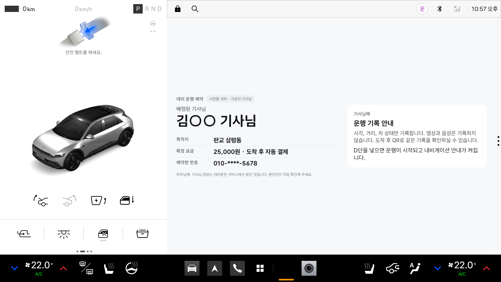
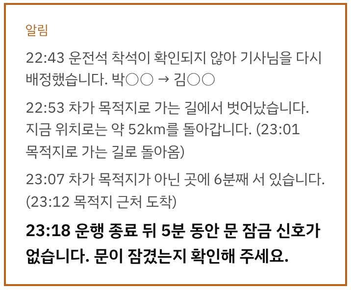
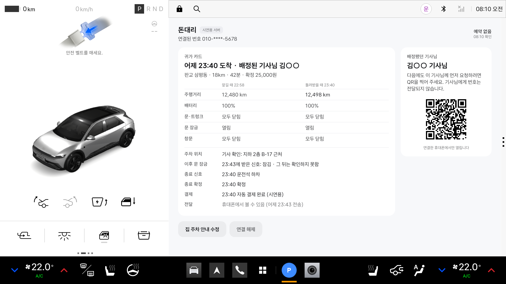

# 코-대리

**대리 호출부터 귀가까지, 코-대리가 챙깁니다.**

코-대리는 대리 호출을 받아 예약을 차에 연결하고, 차의 신호로 운행을 지켜보다가 문제가 생기면 조치하고 차주에게 알리는 Pleos Connect 앱입니다. 팀 테오로빈.

| 타면 예약이 나타남 | 문제가 생기면 차주에게 알림 | 다음 날 차에 남는 이용 내역 |
| --- | --- | --- |
|  |  |  |

- **시연 영상(100초)**: [docs/영상/코-대리_시연영상.mp4](docs/영상/코-대리_시연영상.mp4)
- **직접 눌러 보기**: 심사용 콘솔 https://lrlr-master.com/daeri/console/ (아래 [빠른 시작](#심사위원용-빠른-시작-5분))
- **단위 테스트 102개** (실행: `./gradlew testDebugUnitTest`), 에뮬레이터 확인 기록은 [docs/검증](docs/검증/README.md)

## 차를 건네받는 순간만이 아니라 운행 내내 지켜봅니다

차는 운전석 착석, 주행 여부, 위치, 문 잠금을 관측해 보내고, 코-대리가 그 신호로 판단합니다. 정상일 때는 아무 알림도 없습니다.

- **기사님이 오지 않으면 다시 배정합니다.** 도착 알림 뒤 운전석 착석이 확인되지 않으면 다른 기사님으로 바꾸고, 차 화면의 배정된 기사님도 함께 바뀝니다.
- **가는 길에서 벗어나면 알립니다.** 목적지가 아닌 곳에 오래 서 있어도 알립니다.
- **문이 잠기지 않으면 알립니다.** 운행 종료 뒤 문 잠금 신호가 없으면 차주에게 확인을 요청하고, 잠기면 그 시각을 남깁니다.

기준과 동작은 아래 [운행 중 실시간 관리](#운행-중-실시간-관리)에 있고, 네 가지 모두 에뮬레이터에서 확인했습니다([확인 녹화](docs/검증/README.md)).

| | |
| --- | --- |
| 앱 이름 | 코-대리 (패키지 `com.lrlr.codaeri`) |
| 한 줄 소개 | 대리 호출부터 귀가까지, 코-대리가 챙깁니다 |
| 실행 방법 | 아래 [실행 방법](#실행-방법) |
| 테스트 환경과 필요한 설정 | 아래 [테스트 환경](#테스트-환경) |
| 에뮬레이터 버전과 화면 규격 | Pleos Connect Emulator 2.1.0 (Android 14, API 34), 가로 2560 x 1440 |
| APK 위치 | [`apk/테오로빈_코-대리_release.apk`](apk/테오로빈_코-대리_release.apk) |

기획서, 시연 영상과 콘티, 화면, 에뮬레이터 확인 기록, 조사 자료는 [docs/](docs/README.md)에 모았습니다. 포함된 APK·영상·화면은 기존 버전이며, 아래 문구와 화면 구성 변경은 소스에 반영되어 있습니다. 외부 차주·기사님 페이지는 이 레포의 수정 범위에 포함되지 않습니다.

## 심사위원용 빠른 시작 (5분)

1. Pleos Connect Emulator(API 34)에 `apk/테오로빈_코-대리_release.apk` 를 `adb install` 로 설치하고 코-대리를 엽니다. 위치와 알림 권한을 허용합니다(마이크 권한은 "말로 입력"을 처음 고를 때 묻습니다). 위치가 잡히지 않으면 `adb shell pm grant com.lrlr.codaeri pleos.car.permission.FUSED_LOCATION` 을 한 번 실행합니다. 운행 중 내비게이션 위에 운행 상태를 띄우려면 `adb shell appops set com.lrlr.codaeri SYSTEM_ALERT_WINDOW allow` 도 한 번 실행합니다.
2. PC 브라우저에서 심사용 콘솔 **https://lrlr-master.com/daeri/console/** 을 열고, 차 화면 QR 아래의 연결 코드 여섯 글자를 입력합니다. 휴대폰과 계정, API 키는 필요 없습니다.
3. 콘솔에서 "대리 부르기"를 누르면 15초 안에 차 화면에 "배차 현황"이 뜹니다.
4. Virtual Console에서 운전석과 조수석(또는 뒷좌석)을 같은 착석 상태로 두면 메인 화면에 "출발하기" 버튼가 크게 표시됩니다(착석 값의 방향은 차가 한 번 움직인 뒤에 알 수 있습니다). 버튼를 누르고 기사님 PIN(시연용은 항상 1234)을 입력한 뒤 기어를 D로 바꾸면 운행이 시작됩니다. 기어를 P로 바꾸고 차 화면의 "운행 종료"를 누르면 운행이 종료되고 이용 내역이 남습니다.
5. 콘솔의 "문제 상황" 버튼로 기사님 미도착 재배정, 경로 이탈, 긴 정차, 문 잠금 알림을 확인합니다.

콘솔이 단계마다 에뮬레이터에서 할 일을 알려 줍니다. 자세한 순서는 [5분 확인 순서](#5분-확인-순서-심사용-콘솔)에 있습니다. 예약, 기사님, 결제는 모두 시연용 서버의 가상 데이터입니다.

## 화면 구성

메인 화면에는 버튼 세 개만 있습니다.

- **대리 부르기**: 집, 목적지 선택, 말로 입력 가운데 하나로 목적지를 정해 대리를 부릅니다. 기사님이 배정되면 이 버튼가 **배차 현황**으로 바뀌고, 배정된 기사님, 목적지, 확정 요금을 보여 줍니다. 예약이 잡히면 배차 현황이 스스로 열립니다. P단으로 서 있을 때만 부를 수 있고, 부르기 전에 출발지, 목적지, 예상 거리, 확정 요금을 확인받습니다. 출발 전에는 "호출 취소"로 예약을 취소할 수 있습니다.
- **이용 내역**: 지금까지 마무리한 운행의 이용 내역 목록입니다(최근 20건, 30일 보관). 기사님 줄에서 "전화하기"(시연용)와 "우선 요청"을 누를 수 있습니다.
- **설정**: 집 주차 안내, 비상연락처, 운행 상태 자동 공유(공유할 연락처는 비상연락처와 따로 등록. 둘 다 차 설정과 휴대폰 페이지에서 수정할 수 있음. 시연용이라 실제 발송은 하지 않음), 우선 요청 기사님(이용한 기사님 가운데서 등록, 수정, 삭제), 이용 알림, 번호 연결.

운행이 시작되면 주행, 마무리, 종료 화면이 차 신호에 따라 스스로 바뀌고, 끝나면 메인 화면으로 돌아옵니다.

## 코드 구조

안쪽 계층은 바깥 계층을 모릅니다. 규칙은 `domain` 에만 있고, 저장과 통신은 포트(인터페이스) 뒤에 둡니다.

| 계층 | 패키지 | 하는 일 |
| --- | --- | --- |
| 도메인 | `domain/` | 모델(`Model`, `AppState`), 규칙(`TripRules` 운행 시작·종료 판정, `Handover` 이용 내역, `Guidance` 주차 안내, `VoiceCall`), 포트. `Ports.kt` 는 저장과 통신(`StateRepository`, `DaeriService`, `LinkFactory`), `DevicePorts.kt` 는 차와 기기(`CarSignals`, `LocationSource`, `Announcer`, `SpeechListener`, `DrivingRestriction`, `RouteGuide`)입니다. 안드로이드에 기대지 않습니다. |
| 흐름 | `app/` | 하는 일마다 클래스 하나입니다(아래 표). 포트만 알기 때문에 차 없이 가짜 구현으로 시험합니다. `DaeriController` 는 흐름들을 이어 붙여 화면에 내놓는 창구이고, `AppContainer` 가 실제 구현을 이어 붙입니다. 알림, 프로세스 유지, 통신 복구처럼 앱이 도는 기기에 기대하는 것은 `AppPorts.kt` 에 둡니다. |
| 데이터 | `data/` | `local/FileStateRepository`(차 안 저장: JSON 파일 하나), `remote/HttpDaeriService`(서버 통신), `JsonCodec`, `SecureLinks`. 포트의 구현입니다. |
| 차량 | `car/` | Pleos Vehicle SDK 신호(기어, 운전석, 문, 창문, 배터리), 위치, 음성 인식과 안내 음성, 내비게이션. 기기 포트의 구현입니다. |
| 화면 | `ui/` | `Route`(상태로 화면을 정하는 규칙), `screens/`(화면마다 파일 하나), `Components`, `Theme`. 화면은 상태를 받아 그리기만 합니다. |

흐름 계층의 클래스:

| 클래스 | 맡은 일 |
| --- | --- |
| `AppStateStore` | 앱 상태의 단일 출처. 바꿀 때마다 차 안 저장소에 적습니다. |
| `PairingFlow` | 번호 연결(일회용 QR)과 연결 해제 |
| `BookingSync` | 예약 조회와 차 신호 보고. 상황에 따라 조회 간격을 바꿉니다. |
| `CallFlow` | 대리 부르기: 목적지 정하기(집, 목적지 선택, 말로 입력), 요금 확인, 예약 |
| `TripRecorder` | 운행 기록: 기어와 운전석 신호로 시작, 정차, 종료를 판정해 적습니다. |
| `ParkingGuide` | 집 근처에서 집 주차 안내를 차례로 읽어 줍니다. |
| `EmergencyViewer` | 운행 중 비상연락처 확인 |
| `DestinationRouter` | 출발할 때 목적지를 순정 내비게이션에 넘깁니다. |
| `CardOutbox` | 이용 내역 전송과 재시도 |

한 운행의 흐름: 차 신호(`car`) → `TripRecorder` → `TripRules` 로 판정 → `AppStateStore` 가 상태를 갱신하고 저장 → `CardOutbox` 가 전송 → `Route` 가 화면을 고르고 `ui/screens` 가 그립니다.

단위 테스트는 네 묶음입니다: 도메인 규칙(`DomainTest`), 흐름(`FlowsTest`, 가짜 포트와 가상 시간으로 출발부터 종료, 재시도, 재시작까지), 화면 선택(`RouteTest`), 이전 기록의 표시 호환성(`TripPresentationTest`).

## 흐름

1. **번호 연결**: 차 화면의 일회용 QR(10분, 한 번)을 휴대폰으로 찍고 번호를 입력하면 차와 번호가 연결됩니다. 휴대폰 없이 확인할 때는 QR 아래의 연결 코드를 심사용 콘솔에 입력합니다.
2. **예약 인계**: 연결한 번호로 대리를 부르면, 기사님이 탄 차의 화면에 배정된 기사님, 목적지, 확정 요금이 뜹니다. 기사님에게는 무엇을 기록하는지 안내합니다.
3. **출발**: 탑승은 차가 판정하고, 출발은 "출발하기" 버튼로 확인합니다. 예약이 있고 서 있는 차의 운전석과 다른 자리(조수석이나 뒷좌석)에 사람이 앉으면 메인 화면에서 "출발하기"를 크게 보여 줍니다. 좌석 신호만으로 탑승자의 신원을 확인하지는 않습니다. 누르면 기사님 PIN 네 자리를 묻고(배정된 기사님이 맞는지 확인하는 단계, 시연용 PIN은 항상 1234), 맞으면 "출발 대기 중"으로 바뀌고, D단으로 출발하면 운행이 시작되고 목적지가 순정 내비게이션에 넘어갑니다. 누르지 않고 출발해도 함께 탄 상태면 기록은 시작합니다(누락 방지). 혼자 모는 주행은 대리 운행으로 보지 않습니다. 좌석 신호로 탑승을 알 수 없는 차에서는 배차 현황의 "출발하기"를 누르고 출발합니다.
4. **주차 안내**: 집 위치, 주차 층과 구역·자리, 기사님께 전할 추가 안내를 나누어 등록합니다. 주차 층과 구역·자리는 음성 안내와 주차 위치 확인에 함께 쓰므로 같은 내용을 두 번 적지 않아도 됩니다.
5. **마무리**: 운행 종료는 기사님이 "운행 종료" 버튼로 정합니다. 잠깐 세우고 내리는 경우와 구분하기 위해서입니다. P단에서 운전석이 비었는데 버튼를 누르지 않았으면 음성으로 한 번 알립니다. 목적지에서 직선거리로 1km 넘게 떨어진 곳에서 누르면 "목적지에서 먼 곳입니다. 정말 운행을 종료할까요?"라고 한 번 더 확인받습니다(위치나 목적지 좌표를 모르면 묻지 않습니다). 버튼를 누르면 차가 종료 신호를 보내고 서비스가 종료를 확정합니다. 종료를 적기 전에 시동이 꺼져 30분 넘게 지나면, 다음에 차가 켜질 때 차가 켜져 있던 마지막 시각으로 종료합니다("차 전원 꺼짐"). 종료 뒤 시동이 꺼져 문 잠금 신호를 받지 못하면 차주에게 "확인하지 못했습니다"로 알립니다. 기사님은 주차한 자리를 고를 수 있습니다. 기사님의 운행 요약은 서비스가 기사님께 별도로 전달하는 것으로 계획하며, 차 화면에는 띄우지 않습니다.
6. **결제**: 종료가 확정되면 차주가 서비스에 등록해 둔 결제수단으로 자동 결제됩니다(시연용).
7. **이용 내역**: 차 화면에서는 이용 시간·목적지·요금·실제 주차 위치·문 잠금 상태를 먼저 보여 줍니다. 차량 상태는 "차량 상태 자세히"를 눌러 출발 시와 종료 시를 비교합니다. 잠금은 "23:43 기준 잠김"처럼 마지막으로 확인한 시각과 함께 표시하며, 주차 요청만 있고 기사님 확인이 없으면 실제 위치는 미확인으로 남깁니다. 저장·전송 형식은 유지하고, 기존 기록에 든 표현은 화면에서 해석합니다.

## 차 안에서 대리 부르기

대리 운행 중이 아니고 차가 서 있을 때, 메인 화면의 "대리 부르기"를 누르면 목적지를 정하는 방법 세 가지가 나옵니다.

- **집**: 집 주차 안내에 등록한 집 위치로 부릅니다.
- **목적지 선택**: 목록에서 장소를 눌러 고릅니다.
- **말로 입력**: 목적지를 말합니다("집까지 대리 불러 줘", "강남역").

어느 방법이든 차가 목적지와 확정 요금을 보여 주고 읽어 줍니다. "부르기"를 누르거나(말로 입력에서는 "불러 줘"라고 답해도 됩니다) 해야 예약이 잡힙니다. 예약은 연결된 번호의 예약으로 잡혀 인계 화면으로 이어집니다.

차 앱은 대리를 부르는 여러 경로 가운데 하나입니다. 대리운전 서비스는 휴대폰 앱과 AI 에이전트로도 호출을 받고, 어느 경로로 부르든 같은 번호의 예약이 되어 차에 이어집니다. 이 레포에는 차 앱이 들어 있고, 다른 경로는 시연용 서버의 "대리 부르기"(차주 페이지, 콘솔)로 대신합니다.

- 음성 인식은 Pleos SpeechToText(차 안 인식)를 씁니다. 버튼를 누른 뒤 한 문장만 듣고, 들은 소리와 글은 저장하지 않습니다.
- 시연에서는 집(집 주차 안내에 등록한 위치)과 판교 삼평동, 강남역, 잠실 롯데타워만 고르거나 말할 수 있습니다. 요금은 시연용 서버가 직선거리로 계산합니다.

## 기사님께 차 위치 알리기

기사님이 배정되면 코-대리가 차의 현재 위치를 기사님께 알려 줍니다. 차주가 주차장 어디인지 전화로 설명하지 않아도 됩니다.

- 기사님이 받는 "탑승 전 안내" 페이지에 차가 마지막으로 보낸 위치를 지도 링크와 "몇 분 전" 기준으로 보여 줍니다. 차가 아직 위치를 보내지 못했으면 "아직 받지 못함"으로 적습니다.
- 배정부터 출발(기어가 P를 벗어남)까지만 보입니다. 출발하거나 다른 기사님이 배정되면 그 링크는 닫힙니다.
- 시연에서는 차주 휴대폰 페이지와 심사용 콘솔에 있는 "기사님이 받는 탑승 전 안내" 링크로 열어 봅니다.

## 비상연락처

차주가 차 설정이나 휴대폰 페이지에서 비상연락처(관계와 번호)를 3명까지 미리 등록해 둡니다. 저장한 번호는 서비스에만 두고 차 화면에는 가려서 보여 줍니다. 도착했는데 차주를 깨울 수 없는 때처럼 급할 때 기사님이 연락할 사람입니다.

- 차 화면 홈에는 가운데를 가린 번호만 보입니다.
- 운행 중에는 달리는 화면과 "정차 중" 화면 어디서나 기사님이 "비상연락처 보기"를 누르면 번호가 차 화면에 뜹니다. 유사시 연락할 곳이라 정차를 기다리지 않습니다. 운행이 끝나면 열 수 없습니다. 차는 번호를 저장하지 않습니다.
- 기사님이 확인한 사실과 시각은 차주 휴대폰 페이지의 알림에 남습니다.
- 운행이 끝나면 더는 볼 수 없고, 기사님 휴대폰 페이지에는 번호가 없습니다.

차 화면의 비상연락처 표시와 "비상연락처 보기"는 앱 0.4.8부터 들어 있습니다. `apk/` 의 APK가 그보다 앞선 판이면 소스를 빌드해 확인합니다.

## 운행 중 실시간 관리

차는 예약을 물을 때 운전석 착석, 주행 여부, 위치를 함께 보내고, 서비스가 그 신호로 판단해 차주 휴대폰 페이지에 알립니다. 정상일 때는 아무것도 띄우지 않습니다.

| 상황 | 기준 | 서비스가 하는 일 |
| --- | --- | --- |
| 운전석 착석이 확인되지 않음 | 기사님 도착 알림 뒤 3분(시연용, 실제 권장 5분) | 다른 기사님으로 다시 배정(최대 2번), 차 화면의 배정된 기사님도 바뀜 |
| 경로 이탈 | 돌아가는 거리가 2km를 넘고 출발지와 목적지 사이 직선거리의 30%도 넘음 | 알림, 돌아오면 해결 시각 기록 |
| 긴 정차 | 목적지에서 500m 넘게 떨어진 곳에 P단으로 5분 넘게 서 있음 | 알림 (차단기 앞 같은 짧은 정차는 정상) |
| 문 잠금 신호 없음 | 종료 확정 뒤 5분 | 알림, 잠기면 그 시각 기록 |

운전석 값의 방향을 아직 모르는 차(한 번도 출발한 적 없는 차)는 착석을 "모름"으로 보내고, 서비스는 그동안 다시 배정하지 않습니다.

원칙: 차는 관측한 것만 적고 판단은 서비스가 합니다. 받지 못한 값은 "확인하지 못함"으로 남기고, 영상과 음성은 기록하지 않습니다.

## 시연용 서버

대리운전 서비스의 예약 서버 자리에 같은 모양의 시연용 서버를 씁니다(Cloudflare Workers + Durable Objects, `https://lrlr-master.com`). 예약, 기사님, 결제는 모두 가상이며 화면에 "시연용"이라고 표시합니다.

- 심사용 콘솔 `/daeri/console/`: 차주와 서비스가 하는 일을 PC 브라우저에서 대신 누르는 페이지(아래 [5분 확인 순서](#5분-확인-순서-심사용-콘솔))
- 차주 페이지 `/daeri/c/`: 번호 연결, 시연용 예약, 비상연락처 등록, 결제 상태, 이용 내역
- 기사님 페이지 `/daeri/t/`: 탑승 전 안내(차 위치), 운행 기록(운행 중, 최종 기록)

## 실행 방법

1. Android Studio와 JDK 17 이상(확인은 21), Pleos Connect Emulator(API 34)를 준비합니다. SDK Manager의 SDK Update Sites에 아래 주소를 추가해 시스템 이미지를 받습니다.
   - Apple Silicon: `https://nexus-playground.pleos.ai/repository/raw-releases/connect-avd/2.x/crp-arm64-sys-img.xml`
   - x86_64: `https://nexus-playground.pleos.ai/repository/raw-releases/connect-avd/2.x/crp-sys-img.xml`
2. `apk/테오로빈_코-대리_release.apk` 를 `adb install` 로 설치합니다. 직접 빌드하려면 `./gradlew assembleRelease` (서명 설정 `signing.properties` 가 없으면 디버그 키로 서명됩니다. 결과는 `app/build/outputs/apk/release/`).
3. 앱을 열면 수집 안내가 뜹니다. "동의하고 연결"을 누르면 휴대폰 연결 화면(QR)이 뜹니다. 아래 순서대로 심사용 콘솔에서 연결하고 진행합니다. 휴대폰이 있으면 QR을 찍어 차주 페이지에서 같은 일을 할 수 있습니다.

### 5분 확인 순서 (심사용 콘솔)

PC 브라우저에서 **https://lrlr-master.com/daeri/console/** 을 엽니다. 차주의 휴대폰과 대리운전 서비스가 하는 일은 콘솔에서 누르고, 차의 신호는 에뮬레이터 Virtual Console에서 바꿉니다. 콘솔은 지금 단계와 에뮬레이터에서 할 일을 단계마다 알려 줍니다. 시연용이며 예약, 기사님, 결제는 모두 가상입니다.

| 순서 | 콘솔에서 | 에뮬레이터에서 | 차 화면 |
| --- | --- | --- | --- |
| 1 | 차 화면 QR 아래의 연결 코드 여섯 글자를 입력하고 "연결하기" | | 메인 화면으로 바뀜 |
| 2 | 목적지를 골라 "대리 부르기" | (3번을 보려면 부르기 전에 운전석을 비워 둠) | 15초 안에 예약 인계 화면 |
| 3 | (선택) "3분 기다림 건너뛰기": 기사님이 오지 않는 상황 | 기어는 P 그대로 | 배정된 기사님이 바뀜 |
| 4 | | (5번을 보려면 먼저 `adb emu geo fix 127.0300 37.5100`) 운전석과 조수석을 같은 착석 상태로 두고 기어를 D로 | 운행 시작, 목적지가 내비게이션으로 |
| 5 | (선택) 경로 이탈, 긴 정차 | `adb emu geo fix` 명령(콘솔에 표시), 기어 P | 콘솔과 차주 페이지에 알림 |
| 6 | | 기어를 P로 바꾸고 차 화면의 "운행 종료"를 누름. 내비게이션이 앞에 떠 있으면 코-대리 앱으로 돌아옴. 목적지에서 먼 곳이면 확인 창에서 "운행 종료"를 한 번 더 누름 | 운행 종료, 이용 내역 |
| 7 | 종료 확정, 자동 결제, 이용 내역 확인. (선택) "5분 기다림 건너뛰기": 문이 잠기지 않은 상황 | 문을 잠그면 알림이 정리됨 | |

"기다림 건너뛰기"는 서버가 기다리는 시간만 줄입니다. 판단에 쓰는 신호(운전석 착석, 위치, 문 잠금)는 에뮬레이터의 차가 보낸 것 그대로이고, 조건이 맞지 않으면 아무 일도 일어나지 않고 콘솔이 이유를 알려 줍니다.

그 밖에: 메인 화면의 "설정"에서 집 주차 안내 "등록"에서 집 위치, 주차 층과 구역·자리를 입력해 저장하고 위치를 집 반경 안으로 옮기면(`adb emu geo fix`) 주차 안내가 스스로 시작됩니다. 메인 화면의 "대리 부르기"로 불러도 2번부터 같은 흐름입니다.

단위 시험: `./gradlew testDebugUnitTest`

실시간 관리를 기다림 없이 그대로 확인하려면(에뮬레이터): 운전석 값을 바꿔 둔 채 예약하고 3분 넘게 기다리면 다시 배정됩니다. 운행 중 `adb emu geo fix`로 위치를 목적지 반대쪽으로 옮기면 경로 이탈 알림이, 문을 잠그지 않고 종료한 뒤 5분이 지나면 문 잠금 알림이 차주 페이지에 뜹니다.

## 테스트 환경

- Pleos Connect Emulator 2.1.0 (Android 14, API 34), 화면 가로 2560 x 1440(왼쪽 3분의 1은 차량 영역, 앱은 나머지 영역에 표시), Virtual Console
- 필요한 설정: 인터넷 연결(시연용 서버), 위치·알림·마이크 권한 허용. 그 밖의 계정이나 API 키는 필요 없습니다.
- Pleos Playground SDK: Vehicle, FusedLocation, TextToSpeech, SpeechToText, NaviHelper
- Kotlin, Jetpack Compose, minSdk 28 / targetSdk 34

에뮬레이터에서 확인한 것: 번호 연결, 예약 인계, 주행, 정차 후 재출발, 운전석 하차로 종료, 자동 결제 표시, 주차 안내의 위치 시작, 내비게이션 목적지 전달, 재부팅 뒤 예약 알림. 확인하지 못한 것: 안내 음성의 실제 소리(재생 요청 기록만 확인), 실제 차량.

## 개인정보

- 번호를 연결하기 전에 차 화면에서 모으는 정보(번호, 차 위치, 기어·착석·문·창문·배터리 상태, 주행거리), 쓰는 곳, 보관 기간(30일)을 안내하고 "동의하고 연결"을 받아야 연결 QR이 뜹니다. 연결 해제가 곧 동의 철회입니다.
- 마이크는 "대리 부르기"에서 "말로 입력"을 고른 동안에만 쓰고, 음성은 저장하지도 서버로 보내지도 않습니다(서버에는 알아들은 목적지 이름과 좌표만 갑니다).
- 서버에는 연결한 번호, 시연용 예약, 이용 내역만 올라갑니다. 차주 본인의 번호는 차 화면과 휴대폰 페이지에 그대로 보이고, 비상연락처와 공유 연락처의 번호는 가려서 보여 줍니다. 집 주소와 집 주차 안내 원문은 차 안에만 저장됩니다.
- 쓰기 열쇠와 휴대폰 열쇠는 해시로만 저장하고, 카드는 마지막 갱신 30일 뒤 지워집니다.
- 기사님 페이지에는 출발과 도착 시각, 달린 거리, 요금만 들어 있고 차주의 번호, 집 주차 위치, 차 상태는 들어 있지 않습니다.
- 비상연락처 번호는 서버에만 두고, 운행 중인 차가 요청할 때만 내려 줍니다. 번호 연결을 해제하면 함께 지워집니다.
- 탑승 전 안내 페이지에는 차 위치, 목적지, 확정 요금만 들어 있고 차주의 번호는 들어 있지 않습니다.

## 라이선스

공모전 심사를 위한 열람과 실행만 허용합니다. 자세한 내용은 [LICENSE](LICENSE)를 참고하세요.

