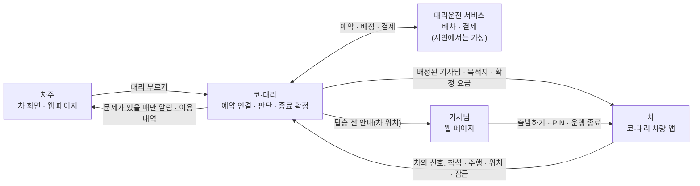
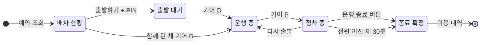

# 코-대리 기획서

코-대리는 대리운전을 맡긴 동안 차의 신호로 운행을 기록하고 지켜보는 서비스이고, 이 문서는 코-대리의 Pleos Connect 차량 앱 기획서입니다. 기사님을 찾아 배정하고 요금을 받는 일은 연동할 대리운전 서비스가 맡을 일이며, 공모전에서는 시연용 서버가 가상 기사님과 모의 결제로 대신합니다.

## 1. 앱 한 줄 소개

### 1.1 한 줄 소개

**부른 대리가 차 화면에 이어지고, 운행은 차가 기록합니다.**

### 1.2 코-대리는

대리운전 분쟁은 언제 운전자가 바뀌었고 그때 차가 어땠는지를 입증하기 어려운 데서 커집니다. 차는 누가 운전했는지는 모르지만, 언제 떠나 어디에 섰고 그때 문과 잠금이 어땠는지는 압니다. 코-대리는 예약의 배정 정보와 차가 본 운행을 하나의 기록으로 묶습니다.

대리를 부르면 배정된 기사님과 목적지, 확정 요금이 차 화면에 뜹니다. 출발하면 차가 운행을 기록하고, 집 근처에서는 주차 방법을 읽어 주고, 기사님이 "운행 종료"를 누르면 그때의 차 상태와 함께 이용 내역에 남깁니다. 이 앱은 코-대리가 차 안의 실제 상황을 알고 차 안에 안내를 띄울 수 있게 해 주는 Pleos Connect 차량 앱입니다.

운행하는 동안 코-대리는 차가 보낸 신호로 네 가지 상황을 봅니다. 기사님이 도착을 알렸는데 운전석에 아무도 앉지 않을 때, 경로를 크게 벗어날 때, 목적지가 아닌 곳에 오래 서 있을 때, 운행을 마쳤는데 문이 잠기지 않을 때입니다. 이때 차주에게 알리고, 기사님이 오지 않으면 다른 기사님을 요청합니다. 판단은 직선거리와 시간으로 단순하게 시작하고, 아무 일 없는 밤에는 아무것도 띄우지 않습니다.

기사님은 앱을 따로 설치하지 않아도 되고, 차주는 달리는 동안 차 안에서 조작할 것이 없습니다.

### 1.3 한눈에 보기

| | |
| --- | --- |
| 무엇 | 대리 운행을 기록하고 지켜보는 코-대리의 Pleos Connect 차량 앱 |
| 누가 쓰나 | 대리기사와 함께 타고 귀가하는 차주, 앱을 설치하지 않고 운행하는 기사님 |
| 차가 하는 일 | 기어, 착석, 문과 잠금, 창문, 배터리, 주행거리, 위치를 보고 코-대리에 보냅니다 |
| 코-대리가 하는 일 | 예약을 차에 잇고, 차의 신호로 네 가지 상황을 판단해 차주에게 알리고, 운행 종료를 확정해 이용 내역을 남깁니다 |
| 대리운전 서비스가 하는 일 | 호출 접수, 기사님 배정, 결제와 정산. 공모전에서는 시연용 서버가 가상으로 대신합니다 |
| 구성 | 차량 앱(이번 출품작), 시연용 서버, 차주와 기사님이 쓰는 웹 페이지 |
| 아직 없는 것 | 실제 기사 배차와 결제, 문자와 푸시 알림, 전화 호출 연결, 차주용 휴대폰 앱. 모두 대리운전 서비스와 연동해야 하는 일입니다(5.1) |

---

## 2. 기획 배경

### 2.1 시장: 대리 호출 10건 중 8건은 아직 전화로 들어옵니다

시장 규모와 기사 수는 국토교통부 2020년 실태조사(조사 기반 추정치)를 기준으로 합니다.

| 지표 | 수치 | 기준 | 출처 |
| --- | --- | --- | --- |
| 시장 규모 | 2조 7,672억 원 (조사 기반 추정) | 2020 | 국토교통부 실태조사 |
| 대리기사 수 | 약 16만 4천 명 | 2020 | 국토교통부 실태조사 |
| 업체 수 | 등록 약 4,000곳, 미등록을 더하면 2만여 곳으로 추정 | 2017 | 뉴시스 |
| 호출 경로 | 전화콜 80%, 앱 20% (업계 추산). 20~30대는 앱을, 40대 이상은 전화를 더 많이 씁니다 | 2022 | 이투데이 |
| 카카오 앱 호출 점유율 | 10~20%대 | 2021 | 테크42 |

앱 회사들도 전화콜 시장으로 들어가고 있습니다. 카카오모빌리티는 앱 점유율이 10~20%대에 머물자 2020년에 전화콜 프로그램 콜마너를 인수했고(테크42), 티맵모빌리티는 콜 관제 업체 로지소프트를 인수했습니다(이코노미스트). 2022년 5월에는 대리운전업이 중소기업 적합업종으로 지정되면서 대기업이 전화콜 시장을 넓히기 어려워졌습니다(이투데이, 아이뉴스24. 기한은 2025년 5월이며, 연장 여부는 확인하지 못했습니다).

코-대리는 이 전화콜을 차 화면으로 옮기는 것을 목표로 하지 않습니다. 호출은 대개 차 밖(식당, 술집)에서 일어나고, 전화에 익숙한 차주가 차 화면으로 부르기 시작할 것이라고 보기 어렵습니다. 코-대리가 맡는 것은 부른 뒤의 운행입니다. 어떤 경로로 불렀든 운행은 차 안에서 일어나고, 예약이 차주 번호로 들어오기만 하면 차에 이을 수 있습니다. 전화로 부른 운행을 잇는 방법은 F2(3.3)에 적었습니다.

### 2.2 차주와 기사님이 겪는 문제

차주는 술에 취한 채 낯선 사람에게 차와 안전, 개인정보를 맡깁니다. 그런데 문제가 생겨도 입증할 방법이 거의 없습니다.

| 차주의 문제 | 어떻게 겪나 | 근거 | 코-대리가 하는 일 |
| --- | --- | --- | --- |
| 흠집 다툼 | 운행 뒤 발견한 흠집을 두고 기사는 "원래 있던 것"이라고 반박합니다. 증거는 배정 기록과 개인 블랙박스뿐입니다 | 서울신문, 로톡 | 출발할 때와 운행을 마칠 때의 문, 트렁크, 잠금, 창문 상태를 시각과 함께 나란히 적습니다(F9). 흠집 자체는 차 신호로 알 수 없습니다 |
| 보상 거절 | 업체나 기사가 보험에 들지 않았다며 보상을 거절하면, 차주가 자기 차 보험으로 처리하고 할증까지 떠안습니다 | 서울신문(소비자원 인용) | 배정된 기사님과, 운행을 시작하고 마친 시각을 예약과 묶어 적습니다(F5, F6, F8). 실제로 누가 운전했는지는 차가 알 수 없고, 보험 연동은 확대 계획입니다 |
| 중간에 내린 기사와 음주운전 혐의 | 기사가 도로에 차를 세우고 떠나면, 차주가 몇 m만 움직여도 음주운전 혐의를 받습니다 | 노컷뉴스, 2023 판결 보도 | 목적지가 아닌 곳에 오래 서 있으면 차주에게 알립니다(3.2). 목적지에서 1km 넘게 떨어진 곳에서 운행을 끝내면 한 번 더 묻고, 위치와 시각을 남깁니다(F8) |
| 주소와 연락처 노출 | 집 주소와 연락처가 기사에게 보입니다. 2021년에는 대리기사 스토킹 사건이 보도됐습니다 | 위드뉴스, 테크42 | 차주 번호를 기사님에게 넘기지 않습니다. 집 주소는 차 안에만 두고, 비상연락처는 가린 채 운행 중에만 보여 줍니다(3.8). 내비 기록을 숨기는 일은 순정 발레 모드가 맡습니다 |
| 들쭉날쭉한 요금 | 법으로 정한 표준요금이 없어서, 같은 15km도 2만 원대에서 4만 원 안팎까지 달라집니다 | 글래스월렛(추정) | 요금을 정하지는 않습니다. 서비스가 정한 확정 요금을 부르기 전과 배차 현황에서 보여 줍니다(F2, F3) |
| 번거로운 호출과 위치 설명 | 취한 상태로 출발지, 목적지, 주차 위치를 입력하고, 통화로 위치를 맞춥니다 | 가설(정량 데이터 없음) | 차 안에서는 집 버튼 하나로 부를 수 있고, 차 위치는 기사님에게 자동으로 알립니다(F2, F4) |
| 낯선 차 조작 실수 | 2020년 한남동 사고에서 경찰은 대리기사가 가속페달을 잘못 다룬 것을 원인으로 결론 내렸습니다 | 다음(2021.4) | 1차 범위에는 넣지 않습니다. 차종별 조작 안내는 확대 계획입니다(5.7) |

기사님도 같은 문제를 안고 있습니다. 운행 중에 일어난 일을 입증할 방법이 없습니다.

| 기사님의 문제 | 어떻게 겪나 | 근거 | 코-대리가 하는 일 |
| --- | --- | --- | --- |
| 말로만 남는 운행 | 폭언과 폭행, 흠집 책임 떠넘기기, 보복성 음주운전 신고가 있어도 입증할 기록이 없습니다 | 분석 | 기사님도 같은 운행 기록을 받습니다(서비스가 전달). 출발과 운행 종료는 기사님이 버튼으로 정합니다(F5, F8) |
| 여러 겹의 비용 | 요금의 약 20%를 수수료로 내고, 프로그램 사용료(평균 4~5개, 개당 1만 5천~2만 원)와 보험료를 따로 냅니다. 월 200만 원을 벌어도 150만 원 안팎이 남습니다 | 비즈한국, 뉴시스 | 이 앱이 직접 풀지는 않습니다. 기사님은 앱을 설치하지 않고 웹 페이지로 이용합니다 |
| 겹치는 보험 | 업체마다 자기 단체보험에 들라고 해서 보험을 2~3개씩 듭니다 | 노컷뉴스, 금융위원회 | 이 앱이 직접 풀지는 않습니다. 차가 기록한 운행 구간이 운행 건별 보험의 재료가 될 수 있지만, 보험사가 정할 일입니다(6.5) |
| 거절하기 어려운 위험한 손님 | 호출을 거절하면 불이익이 있어 위험한 손님도 취소하기 어렵습니다. 2025년 11월 대전에서는 기사가 숨지는 사건이 있었습니다 | 프레시안 | 1차 범위에는 넣지 않습니다. 운행 중 운전석 문이 열리면 알리는 기능을 확대 후보로 둡니다(5.7) |
| 낯선 차 조작과 책임 | 차종마다 변속, 시동, 주차브레이크 방식이 다른데, 사고가 나면 책임은 기사가 집니다 | 다음(2021.4) | 확대 계획입니다(5.7) |
| 처음 가는 집, 쌓이지 않는 단골 | 주차 위치를 물으려고 차주를 깨웁니다. 수천 명을 태워도 다시 찾는 손님이 쌓이지 않습니다 | 가설 | 집 주차 안내(F7)와 우선 요청 기사님(F9) |

### 2.3 문제의 뿌리: 누가 언제 운전했는지 입증할 수 없습니다

불만을 하나하나 따라가 보면 네 가지 구조 문제가 나옵니다. 이 가운데 차가 도울 수 있는 것은 3번과 4번입니다. 차가 문제를 없애지는 못하고, 다툼을 가릴 때 쓸 기록을 남깁니다.

| 구조 문제 | 내용 | 차가 도울 수 있나 |
| --- | --- | --- |
| 1. 법이 없는 업종 | 대리운전업은 자유업이라 사업자등록만 하면 운영할 수 있고, 기사 자격 요건도 없습니다. 2007~2009년에 법안 3건이 나왔지만 통과되지 못했습니다(매일신문, 뉴시스) | 아니요 |
| 2. 여러 겹으로 쪼개진 중개 구조 | 수천 개의 전화콜 업체, 콜 공유 프로그램, 플랫폼 앱이 겹쳐 있어서 고객은 어느 업체 기사가 오는지, 어떤 보험이 적용되는지 모릅니다 | 아니요. 서비스가 풀 일입니다 |
| 3. 보험 사각지대 | 기사 개인보험, 업체 단체보험, 차주 자동차보험이 얽혀 있습니다. 어느 보험이 책임질지는 사고 당시 누가 운전했는지에 달려 있습니다 | 일부. 차가 운행을 시작하고 마친 시각을 적습니다. 어느 보험이 책임질지는 여전히 보험사와 법이 정합니다 |
| 4. 남지 않는 인계 시점 | 보험, 흠집, 음주운전 책임이 모두 차를 넘겨주고 받는 시점에서 갈립니다. 그런데 이 시점의 기록은 앱 배정 로그와 개인 블랙박스뿐입니다. 소비자원도 이 둘을 핵심 증거로 꼽습니다(서울신문) | 일부. 착석, 출발 확인, 기어로 운전자가 바뀌었을 시점을 적습니다. 이 기록이 증거로 인정될지는 아직 모릅니다(5.6) |

스마트폰 앱은 누가 불렀고 누가 배정됐는지만 알고, 차가 실제로 어떻게 움직였는지는 모릅니다. 차는 움직임을 알지만 그것이 어느 예약의 운행인지는 모릅니다. 코-대리는 이 둘을 하나의 운행으로 묶습니다. 서비스가 아는 배정된 기사님과, 차가 아는 출발 확인과 PIN, 기어가 P를 벗어난 시각, 정차 위치, 운행을 마친 위치와 시각, 그때의 차 상태를 한 기록에 나란히 적습니다.

### 2.4 왜 차 안이어야 하는가

| | 기사 휴대폰 앱 | 웹 페이지 (설치 없음) | 손님의 차 (코-대리) |
| --- | --- | --- | --- |
| 기사님이 설치할 앱 | 하나 더 늘어납니다. 이미 4~5개를 씁니다 | 없습니다 | 없습니다 |
| 출발과 도착 기록 | 휴대폰 GPS로 자동으로 남습니다 | 기사님이 직접 알려야 합니다 | 출발은 기어와 착석으로 저절로, 종료는 기사님의 버튼으로 남습니다 |
| 운전자가 바뀐 시점 | 기사 휴대폰을 기준으로 봅니다 | 기사님의 말에 기댑니다 | 착석, 출발 확인과 PIN, 기어로 차가 봅니다 |
| 차 상태 (문, 잠금, 창문) | 모릅니다 | 모릅니다 | 압니다 |
| 다음 날에도 남는가 | 기사 휴대폰에만 남습니다 | 링크를 잃으면 사라집니다 | 차 화면과 차주 페이지에 30일 남습니다 |

차 안으로 들어가는 의미는 헤드유닛에 호출 버튼을 하나 더 다는 데 있지 않습니다. 차의 데이터와 화면을 대리 운행 한 건에 묶는 데 있습니다.

**사업 관점**

- **호출 경로와 상관없는 접점**: 앱 호출은 시장의 20% 정도이고 나머지는 전화입니다. 코-대리는 호출을 차로 옮기려 하지 않고 부른 뒤의 운행을 맡으므로, 앱으로 부르든 전화로 부르든 예약이 차주 번호로 들어오면 차에 이을 수 있습니다. 전화 호출을 잇는 콜센터 연동은 아직 만들지 않았습니다(F2).
- **먼저 들어가는 연동**: 차량 데이터를 쓰려면 OEM의 앱 마켓에 입점하고 권한을 승인받아야 합니다. 먼저 들어가면 유리할 수 있지만, 권한을 어디까지 승인받을지는 입점 절차에서 확인해야 합니다(5.3).
- **OEM과 같은 방향**: 현대차그룹은 2026년 5월 그랜저부터 플레오스 커넥트를 넣고, 2030년까지 약 2,000만 대로 넓힐 계획입니다. 처음에는 음악, 영상, 내비 앱이 중심이고, 차량 관리 앱을 늘려 갈 계획입니다(현대차그룹 뉴스룸, 2026.4.30). 대리운전은 차량 데이터를 운행 기록으로 바로 쓸 수 있는 서비스입니다.
- **보험 상품의 재료**: 차가 기록한 운행 구간은 운행 건별로 값을 매기는 대리운전 보험의 재료가 될 수 있습니다. 상품을 만드는 것은 보험사와 금융당국의 일이고, 이 앱이 약속하는 범위는 아닙니다.

**가장 강한 반론과 답**

- "고객은 호출할 때 차 밖(식당, 술집)에 있고, 대부분 전화를 건다." 맞습니다. 그래서 코-대리는 호출을 차 화면으로 옮기려 하지 않습니다. 차 화면은 부른 뒤의 일, 곧 배차 현황, 출발 확인, 주차 안내, 운행 종료처럼 기사님이 차 안에서 하는 일을 맡습니다. 차 안에서 부르기는 이미 차에 타 있을 때 쓰는 보조 경로입니다. 지금 차 밖에서 부르는 길은 차주 웹 페이지뿐이고, 전화와 휴대폰 앱은 대리운전 서비스와 연동한 뒤에 잇습니다(F2).
- "적용 차량이 적다." 플레오스 커넥트는 2026년 5월부터 들어가기 시작했고, 기존 ccNC 차량에는 넣기 어렵다는 보도가 있습니다(MTN, 2026.4.30). 대리를 부르는 차는 아직 대부분 기존 차입니다. 그래서 기존 커넥티드 차량을 클라우드 API(차량 상태 원격 조회)로 잇는 단계를 확대 계획에 넣었습니다(5.7).

### 2.5 역할을 나눕니다

- 예약이 아는 것: 누가 불렀는지, 어느 기사님이 배정됐는지, 목적지와 요금. 대리운전 서비스에서 받습니다.
- 차가 아는 것: 실제로 언제 떠났고 얼마나 달려 어디에 섰는지, 그때 차가 어땠는지.
- 운행 종료를 확정하는 일은 코-대리가 하고, 결제는 대리운전 서비스가 합니다. 차는 그 판단에 쓸 신호를 보냅니다.
- 차는 운전자가 누구인지 알지 못합니다. 화면에 뜨는 기사님 이름은 코-대리의 배정 정보이고, 출발할 때 넣는 PIN은 배정된 기사님이 맞는지 한 번 더 확인하는 장치입니다. 이 앱은 배정 정보와 차가 본 것을 섞지 않고 나란히 적습니다.

### 2.6 이미 있는 것과의 차이

대리에 필요한 차의 부품은 이미 양산차에 들어 있습니다. 빠진 것은 이 부품들을 대리 호출, 배차, 결제와 잇는 일입니다.

| 이미 있는 것 | 하는 일 | 코-대리와 다른 점 |
| --- | --- | --- |
| 현대 발레 모드 (ccNC) | 비밀번호로 화면과 버튼 조작을 막고, 시작 시각, 시동을 끈 시각, 주행 거리와 시간, 최고 속도를 마이현대 앱에 보여 줍니다 | OEM이 운행을 기록한 선례입니다. 다만 차주가 직접 켜야 하고 대리 플랫폼과 이어지지 않습니다. 이 기능을 모르는 차주가 많다는 보도도 있습니다(위드뉴스) |
| Pleos 발레 모드 | 비밀번호로 조작을 막아 개인정보를 지킵니다 | 차주가 없을 때를 위한 기능입니다. 코-대리는 차주가 함께 타는 귀가를 예약, 결제, 다음 이용과 잇습니다 |
| 테슬라 발레 모드 | 최고 속도를 제한하고, 글러브박스를 잠그고, 주소와 연락처를 숨깁니다 | 개인정보를 잠그는 기능의 기준이 됩니다. 운행 기록과 대리 연동은 없습니다 |
| 현대 디지털 키 2 공유 | 차주가 디지털 키를 다른 사람과 나눕니다 | 대리하는 동안만 쓰는 임시 키의 바탕이 됩니다. 외부 사업자에게 열려 있는지는 확인하지 못했습니다 |
| 니오(NIO) 지아샹, 중국 | 니오 앱의 차량 서비스 메뉴에서 대리운전을 주문합니다. 유료 서비스 패키지에 대리 혜택이 들어 있습니다(신추싱, IT之家) | OEM 앱이 대리를 부르는 창구가 된 사례입니다. 차 안에서 본 운행 정보는 쓰지 않습니다 |
| 휴대폰 대리 앱 (카카오T 대리, 티맵 안심대리, 대구로 대리운전) | 호출, 요금, 기사 위치, 운전 점수, 가족에게 보내는 안심 문자를 제공합니다 | 차 안의 신호(착석, 기어, 문, 잠금)를 쓰는 대리 앱은 찾지 못했습니다. 주차를 마치고 문이 잠긴 것까지 차가 확인해 알려 주는 앱도 찾지 못했습니다 |
| 다른 출품작 (공개 소개글 362건, 2026-11-10 확인) | 대리운전을 다룬 출품작은 없습니다. 가까운 것은 차를 맡길 때 인증을 거는 보안 앱, 렌터카와 공유 차량을 넘겨줄 때 상태를 적는 앱입니다 | 인수인계 앱은 넘겨주는 순간의 상태를 적습니다. 코-대리는 운행 내내 예약과 차의 신호를 맞춰 보고, 기사님이 오지 않거나 경로를 벗어나거나 문이 잠기지 않으면 알립니다 |

대리에 필요한 차의 기능은 크게 세 가지입니다. 운행 기록, 대리하는 동안만 쓰는 임시 키, 개인정보 잠금입니다. 코-대리는 이 가운데 공모전 SDK로 할 수 있는 운행 기록과, 운전자가 바뀌었을 시점을 적는 일부터 만듭니다. 임시 키와 개인정보 잠금은 차량 API가 외부 사업자에게 열리면 더합니다(5.7).

---

## 3. 앱 주요 기능 및 차량 특화 요소

### 3.1 서비스 구조

차는 보고, 코-대리는 판단해 알립니다. 기사님을 찾고 요금을 받는 일은 대리운전 서비스가 맡고, 공모전에서는 시연용 서버가 대신합니다. 차주는 처음에 한 번 번호를 연결하면, 그다음부터는 부르기만 하면 됩니다.

### 3.2 핵심 기능: 코-대리의 실시간 관리

차는 예약을 물을 때 운전석 착석, 주행 여부, 위치를 함께 보내고, 코-대리는 이 신호로 판단합니다. 아무 일이 없으면 아무것도 알리지 않습니다.

| 상황 | 기준 | 코-대리가 하는 일 |
| --- | --- | --- |
| 기사님이 오지 않음 | 도착을 알린 뒤에도 운전석에 아무도 앉지 않습니다(기본 5분, 시연에서는 3분) | 대리운전 서비스에 다른 기사님을 요청합니다(최대 2번. 시연에서는 가상 기사님으로 바꿉니다). 차 화면의 기사님도 함께 바꿉니다 |
| 경로를 벗어남 | 돌아가는 거리가 2km를 넘고, 출발지와 목적지 사이 직선거리의 30%도 넘습니다 | 차주에게 알립니다. 경로로 돌아오면 그 시각을 적습니다 |
| 엉뚱한 곳에 오래 서 있음 | 목적지에서 500m 넘게 떨어진 곳에 P단으로 5분 넘게 서 있습니다 | 차주에게 알립니다. 차단기 앞처럼 잠깐 서는 것은 알리지 않습니다 |
| 문이 잠기지 않음 | 운행 종료를 확정하고 5분이 지나도 잠금 신호가 없습니다 | 차주에게 확인을 요청합니다. 잠기면 그 시각을 적습니다. 차 전원이 꺼져 신호를 받지 못하면 "차의 전원이 꺼져 문 잠금을 확인하지 못했습니다"라고 알립니다 |

- 운행 상태 자동 공유: 차주가 설정에서 "운행 상태 자동 공유"를 켜고, 공유할 연락처를 비상연락처와 따로 3명까지 정합니다. 누구에게 알리는지는 차주 페이지에 보여 줍니다. 지금은 설정과 대상만 저장하고, 실제 문자는 서비스와 연동한 뒤에 보냅니다.
- 착석 신호를 받을 수 없거나 믿기 어려운 차에서는 착석을 "모름"으로 보내고, 코-대리는 그동안 기사님을 바꾸지 않습니다.
- 경로는 실제 도로 대신 직선거리를 기준으로 단순하게 판단하는 데서 시작합니다. 알림은 차주 휴대폰 페이지의 알림 칸에 띄우고, 문자와 푸시는 서비스와 연동할 때 더합니다. 기준값(5분, 2km, 30%, 500m)은 시연에 맞춰 정한 값이라, 실제 운행 데이터로 다시 맞춰야 합니다.

### 3.3 호출부터 귀가까지

| 언제 | 기능 | 쓰는 신호 |
| --- | --- | --- |
| 처음 한 번 | F1 차와 번호 연결 | |
| 부를 때 | F2 대리 부르기 | 기어, 음성 인식, 위치 |
| 배정된 뒤 | F3 배차 현황 (타면 예약이 나타남) | |
| 배정된 뒤 | F4 기사님에게 차 위치 알리기 | 위치 |
| 출발할 때 | F5 출발 확인과 기사님 PIN | 착석, 기어 |
| 달리는 동안 | F6 운행 기록과 내비 연동 | 기어, 주행거리, 위치, 내비 |
| 집 근처 | F7 집 주차 안내 | 위치, 음성 안내 |
| 도착했을 때 | F8 운행 종료와 결제 | 기어, 착석, 위치 |
| 다음 날 | F9 이용 내역과 우선 요청 기사님 | 문, 잠금, 창문, 배터리 |
| 급할 때 | F10 비상연락처 | |

**F1 차와 번호 연결**
앱은 먼저 무엇을 모으고 얼마나 보관하는지 알려 줍니다. 차주가 "동의하고 연결"을 누르면 차 화면에 한 번만 쓸 수 있는 연결 QR(10분)을 띄웁니다. 차주가 휴대폰으로 QR을 찍어 번호를 넣으면 연결이 끝납니다. 회원가입도 비밀번호도 없습니다. 연결을 해제하면 동의도 철회됩니다. 휴대폰 없이도 연결할 수 있도록 QR 아래에 여섯 글자 연결 코드를 함께 보여 줍니다.

**F2 대리 부르기**
어디서 부르든 차주 번호로 들어온 예약은 차에 이어집니다. 다만 지금 부를 수 있는 길은 차 화면과 차주 웹 페이지 둘입니다.
- 차 안에서: 차를 P단에 세우면 "대리 부르기"를 쓸 수 있습니다. 기어 값을 받을 수 없을 때는 막습니다. 달리는 중에는 메인 화면에 "정차 중에만 이용할 수 있습니다."라고 보여 줍니다. 목적지는 "집", "목적지 선택", "말로 입력" 가운데 하나로 정합니다. 그러면 출발지, 목적지, 예상 거리, 확정 요금을 보여 주고 읽어 줍니다. 차주가 "부르기"를 누르거나 "불러 줘"라고 답해야 예약을 잡습니다. 말을 알아듣지 못하면 들은 말을 보여 주고 다시 묻습니다. 짐작해서 예약하지 않습니다. 기사님이 출발하기 전에는 "호출 취소"로 예약을 취소할 수 있습니다.
- 차 밖에서: 지금은 차주 웹 페이지의 "대리 부르기"로 부릅니다(심사에서는 심사용 콘솔도 씁니다). 차주용 휴대폰 앱과 AI 에이전트 호출은 아직 만들지 않았습니다.
- 전화로: 이 앱은 전화 호출을 받지 않습니다. 그런데 대리 호출의 대부분은 전화로 들어옵니다(2.1). 코-대리는 차와 예약을 차주 번호로 잇기 때문에, 전화를 받은 콜센터가 발신 번호를 붙여 예약을 넘기면 전화로 부른 운행도 같은 방식으로 차에 뜹니다. 콜센터나 콜 프로그램과 연동해야 하는 일이라 확대 계획에 둡니다(5.7). 가족이 대신 건 전화처럼 발신 번호가 연결한 번호와 다르면 차 화면의 QR로 맞춥니다(5.6).

**F3 배차 현황 (타면 예약이 나타남)**
기사님이 배정되면 메인 화면의 "대리 부르기"가 "배차 현황"으로 바뀌고 저절로 열립니다. "배정된 기사님 김○○ · 판교 삼평동 · 확정 25,000원". 차주는 뒷자리에서 화면의 이름과 눈앞의 기사님을 맞춰 봅니다. 예약이 취소되거나 기사님이 바뀌면 화면도 따라 바뀝니다. 예약을 찾으려고 누를 것은 없습니다.

**F4 기사님에게 차 위치 알리기**
기사님이 받는 "탑승 전 안내" 페이지에 차가 마지막으로 보낸 위치를 지도 링크와 "몇 분 전 기준"으로 보여 줍니다. 위치를 아직 받지 못했으면 "아직 받지 못함"으로 적습니다. 이 링크는 배정부터 출발(기어가 P를 벗어날 때)까지만 열어 두고, 출발하거나 다른 기사님이 배정되면 닫습니다. 차주가 주차장 어디에 차가 있는지 전화로 설명하지 않아도 됩니다.

**F5 출발 확인과 기사님 PIN**
예약이 있는 차가 서 있고, 운전석과 다른 자리(조수석이나 뒷좌석)에 사람이 앉으면 메인 화면에 "출발하기"를 크게 띄웁니다. 기사님이 누르면 PIN 네 자리를 묻습니다. PIN은 대리운전 서비스가 배정할 때마다 무작위 네 자리로 새로 만들어 기사님과 차에만 보냅니다. 기사님이 다시 배정되면 PIN도 바뀝니다. 시연에서는 기사님 안내 페이지와 심사용 콘솔에서 볼 수 있습니다. PIN이 맞으면 "출발 대기 중"으로 바뀌고, D단으로 출발하면 운행을 시작합니다. 버튼을 누르지 않고 출발해도 두 사람이 함께 타 있으면 기록을 시작합니다. 기록이 빠지지 않게 하기 위해서입니다. 혼자 모는 주행은 대리 운행으로 보지 않습니다. 착석 신호를 받을 수 없는 차에서는 배차 현황의 "출발하기"를 누르고 출발합니다.

**F6 운행 기록과 내비 연동**
출발 시각, 주행거리, 달린 시간을 적고, 예약한 목적지를 순정 내비게이션에 넘깁니다. 출발할 때는 기사님에게 한 문장을 읽어 줍니다. "대리 운행의 시간과 거리, 차량 상태를 기록합니다. 영상과 음성은 저장하지 않습니다." 운행하는 동안에는 내비 지도가 앞에 있고, 코-대리는 지도를 가리지 않습니다. 앱 화면이 가려져 있으면 지도 위에 작은 표시만 두 줄로 띄웁니다("김○○ 기사님 운행 중", "판교 삼평동으로"). 이 표시는 평소에는 접어 두고, 알릴 것이 있을 때만 펼칩니다. 끝까지 예약과 이어지지 않은 주행은 차주의 평소 주행이므로 기록에 남기지 않습니다.

**F7 집 주차 안내 (선택)**
차주는 집 위치, 주차 층과 구역·자리, 기사님에게 전할 말을 나눠서 등록합니다. 아파트·오피스텔인지 기타인지 고르고, 꼭 필요한 칸을 채우면 저장할 수 있습니다. 운행 중 차가 집 반경 밖에 있다가 안으로 들어오면 안내를 읽어 줍니다. 달리는 동안 화면에는 한 줄만 보이고, 나머지는 음성으로 전합니다. 이용 내역에는 이 내용을 실제 주차 위치가 아니라 "안내한 위치"로 적습니다.

**F8 운행 종료와 결제**
운행 종료는 한순간이 아니라 몇 단계로 나눠 봅니다(3.4).
- P단으로 서면 "정차 중" 화면을 엽니다. 차단기 앞에서 섰다가 다시 출발하면 같은 운행으로 이어 적습니다.
- 운행은 기사님이 "운행 종료"를 눌러야 끝납니다. 잠깐 세우고 내리는 경우와 구분하려고, 운전석이 비는 것만으로는 끝내지 않습니다. P단에서 운전석이 비었는데 버튼을 누르지 않았으면 "운행을 마치셨다면 화면의 운행 종료를 눌러 주세요."라고 한 번 알려 줍니다.
- 목적지에서 직선거리로 1km 넘게 떨어진 곳에서 누르면 한 번 더 묻습니다. "목적지에서 먼 곳입니다. 정말 운행을 종료할까요?" 버튼은 "돌아가기"와 "운행 종료"입니다. 위치나 목적지 좌표를 모르면 묻지 않습니다.
- 운행 종료를 적기 전에 차 전원이 꺼진 채 30분이 지나면, 다음에 차가 켜질 때 마지막으로 켜져 있던 시각으로 운행을 끝냅니다. 이용 내역에는 "차 전원 꺼짐"으로 적습니다.
- 코-대리가 운행 종료를 확정하면 결제로 넘어갑니다. 공모전에서는 결제 완료만 보여 주는 모의 결제이고, 실제 결제는 대리운전 서비스의 결제나 차량 내 결제(인카 페이먼트)와 이어야 합니다.
- 기사님은 차를 세운 자리를 고르거나 말로 남기고, 운행을 마친 화면에서 고칠 수 있습니다.

**F9 이용 내역과 우선 요청 기사님**
차 화면의 "이용 내역"(최근 20건, 30일 보관)과 차주 휴대폰 페이지에 운행마다 기록을 남깁니다. 이용 시간, 목적지, 요금, 실제 주차 위치, 문 잠금 상태를 먼저 보여 주고, "차량 상태 자세히"에서 출발할 때와 운행을 마칠 때의 문, 트렁크, 잠금, 창문, 주행거리, 배터리 사용량을 나란히 보여 줍니다. 잠금은 "23:43 기준 잠김"처럼 마지막으로 확인한 시각과 함께 적습니다. 기사님 줄의 별 버튼("우선 요청")을 누르면 다음 호출을 그 기사님에게 먼저 보내 달라고 요청해 둡니다. 그 기사님이 받지 못하면 다른 기사님에게 넘깁니다. 실제로 먼저 묻는 일은 배차하는 대리운전 서비스가 받아 줘야 하고, 시연에서는 시연용 서버가 대신합니다. 약속하는 것은 먼저 물어본다는 데까지이고, 손님 번호는 기사님에게 넘기지 않습니다. 우선 요청 기사님은 설정에서도 바꾸거나 지울 수 있습니다.

**F10 비상연락처**
차주는 차 설정이나 휴대폰 페이지에서 비상연락처(관계와 번호, 3명까지)를 등록합니다. 번호는 서비스에만 두고, 차 화면에는 가려서 보여 줍니다. 도착했는데 차주를 깨울 수 없을 때처럼 급할 때는 기사님이 운행 중이나 정차 중 화면에서 "비상연락처 보기"를 눌러 번호를 확인합니다. 이 버튼은 등록 여부와 상관없이 늘 같은 자리에 둡니다. 기사님이 번호를 확인한 사실과 시각은 차주 휴대폰 페이지에 남고, 운행이 끝나면 번호를 더는 보여 주지 않습니다.

### 3.4 운행 상태와 바뀌는 조건

| 상태 변화 | 조건 | 차가 하는 일 |
| --- | --- | --- |
| 배차 현황 → 출발 대기 | 운전석과 다른 자리에 사람이 앉고, 기사님이 "출발하기"를 눌러 PIN을 넣습니다 | "출발 대기 중"을 띄웁니다 |
| 출발 대기 → 운행 중 | 기어가 P를 벗어납니다 | 기록을 시작하고, 출발 안내를 읽고, 목적지를 내비에 넘깁니다 |
| 운행 중 → 정차 중 | 기어를 P에 둡니다 | "정차 중" 화면을 엽니다 |
| 정차 중 → 운행 중 | 다시 출발합니다 | 같은 운행으로 이어 적습니다 |
| 정차 중 → 종료 확정 | 기사님이 "운행 종료"를 누릅니다. 목적지에서 1km 밖이면 한 번 더 묻습니다 | 종료 신호를 보내고, 코-대리가 확정합니다 |

### 3.5 화면 구성

메인 화면에는 버튼을 세 개만 둡니다. 왼쪽의 큰 카드는 "대리 부르기"이고, 기사님이 배정되면 "배차 현황"으로 바뀝니다. 오른쪽 두 줄은 "이용 내역"과 "설정"입니다. 운행을 시작하면 운행 중, 정차 중, 마친 화면이 차 신호에 따라 저절로 바뀌고, 운행이 끝나면 메인 화면으로 돌아옵니다.

| 화면 | 언제 | 주요 내용 |
| --- | --- | --- |
| 연결 | 처음, 연결을 해제한 뒤 | 무엇을 모으는지 안내, "동의하고 연결", 일회용 QR, 연결 코드 |
| 메인 | 평소 | "대리 부르기" 또는 "배차 현황", "이용 내역", "설정". 달리는 중에는 "정차 중에만 이용할 수 있습니다." |
| 대리 부르기 | P단일 때 | "집", "목적지 선택", "말로 입력". 부르기 전 확인("부르기", "취소") |
| 배차 현황 | 배정된 뒤 | 배정된 기사님, 목적지, 확정 요금, "호출 취소", "출발하기" |
| PIN 입력 | "출발하기"를 누르면 | 네 자리 입력, "확인", "취소" |
| 운행 중 | 기어 D | 목적지, "지도로 돌아가기", "비상연락처 보기". 후진할 때는 "주차 중"으로 바꾸고 안내 음성을 멈춥니다 |
| 내비 위 표시 | 앱 화면이 가려져 있을 때 | 운행 중 한 줄, 배정된 기사님, 주차 안내 |
| 정차 중 | 기어 P | 거리, 시간, 요금, 주차 자리, "운행 종료", "비상연락처 보기" |
| 운행을 마친 화면 | 운행 종료를 확정한 뒤 | 결제, 주차 위치(수정), 문 잠금 |
| 이용 내역 | 메인에서 | 운행 목록, "차량 상태 자세히", "전화하기", "우선 요청" |
| 설정 | 메인에서 | 집 주차 안내, 비상연락처, 운행 상태 자동 공유, 우선 요청 기사님, 이용 알림, 번호 연결 |

### 3.6 차량 특화 요소

| 신호와 기능 | SDK | 어디에 쓰나 | 참고 |
| --- | --- | --- | --- |
| 기어 위치 | Vehicle | 출발과 정차를 알고, P단에서만 부르게 하고, 달리는 동안 조작을 막습니다 | |
| 좌석 착석 | Vehicle | 함께 탔는지(출발하기), 운전석이 비었는지(운행 종료 안내), 기사님이 왔는지 봅니다 | 차종별 정확도는 실차에서 검증해야 합니다 |
| 주행거리 | Vehicle | 운행 거리를 잽니다 | |
| 배터리 잔량 | Vehicle | 이번 운행에 쓴 양을 계산합니다 | |
| 문, 트렁크, 후드 열림, 문 잠금, 창문 위치 | Vehicle | 출발할 때와 운행을 마칠 때를 비교하고, 문이 잠겼는지 확인합니다 | |
| 위치 | FusedLocation | 기사님에게 차 위치를 알리고, 경로를 벗어났는지, 오래 서 있는지, 집 근처인지, 목적지에서 먼 곳인지 봅니다 | |
| 순정 내비게이션 | NaviHelper | 예약한 목적지를 넘깁니다 | 남은 거리와 도착 신호는 다음 단계에서 씁니다 |
| 음성 인식 | SpeechToText | 말로 대리를 부릅니다. 버튼을 누른 뒤 한 문장만 듣고, 저장하지 않습니다 | 사람 목소리를 얼마나 잘 알아듣는지는 실차에서 검증해야 합니다 |
| 음성 안내 | TextToSpeech | 출발 안내, 부르기 확인, 집 주차 안내, 운행 종료 안내를 읽어 줍니다 | |
| 주행 중 화면 제한 | CarUxRestrictions | 달리는 동안 입력을 막습니다 | |
| HTTPS 통신 | | 예약을 묻고 차의 신호를 보냅니다. 기사님을 기다릴 때는 5초, 운행 중에는 15초, 평소에는 60초마다 보내고, 앱 화면이 가려져 있어도 계속 보냅니다 | |
| 부팅 뒤 자동 실행 | | 차주가 앱을 열지 않아도 예약을 받습니다 | 실차에서 검증해야 합니다 |

### 3.7 지키는 원칙

- 차가 본 것과 판단을 나눕니다. 차가 본 것, 서비스가 알려 준 것, 사람이 확인한 것을 화면에서 구분해 적습니다.
- 차는 증인이지 감시자가 아닙니다. 급가속 점수 같은 평가는 만들지 않고, 기록한다는 사실을 기사님에게 먼저 알립니다. 운행 데이터를 기사 평가나 배차에 쓰면 단체교섭 대상이 될 수 있습니다(2026년 중앙노동위원회 판정, 매일노동뉴스). 그래서 코-대리는 기록을 운행 확인과 이용 내역에만 씁니다.
- 기록은 양쪽의 것입니다. 기사님도 같은 운행 요약을 받습니다(서비스가 전달).
- 달리는 동안에는 조작을 받지 않습니다. 대리 부르기와 설정은 P단에서 할 수 있고, "비상연락처 보기"만 예외로 둡니다.
- 통신이 끊겨도 기록은 차에 남고, 다시 연결되면 올립니다. 받지 못한 값은 "확인하지 못함"으로 남깁니다.

### 3.8 개인정보

- 번호를 연결하기 전에 무엇을 모으는지(번호, 차 위치, 기어·착석·문·창문·배터리 상태, 주행거리), 어디에 쓰는지, 얼마나 보관하는지(30일) 알려 주고 동의를 받습니다. 연결을 해제하면 동의도 철회됩니다.
- 마이크는 "말로 입력"을 고른 동안에만 씁니다. 음성은 저장하지도, 서버로 보내지도 않습니다. 서버에는 알아들은 목적지 이름과 좌표만 보냅니다.
- 집 주소와 집 주차 안내 원문은 차 안에만 저장합니다.
- 비상연락처와 공유 연락처의 번호는 가려서 보여 주고, 비상연락처 번호는 운행 중인 차가 요청할 때만 내려 줍니다.
- 기사님 페이지에는 출발과 도착 시각, 달린 거리, 요금만 있습니다. 차주의 번호, 집 주차 위치, 차 상태는 기사님 페이지에서 볼 수 없습니다.

---

## 4. 주요 사용 시나리오

### 4.1 누가 쓰는가

| 누구 | 모습 | 하는 일 |
| --- | --- | --- |
| 차주 A씨 | 40대 직장인입니다. 금요일 회식 뒤 대리를 불러 귀가합니다 | 처음에 한 번 번호를 연결하고, 대리를 부르고, 다음 날 이용 내역을 봅니다 |
| 기사님 김○○ | 호출 프로그램을 여러 개 쓰는 대리기사입니다 | 앱을 설치하지 않고 탑승 전 안내를 받고, "출발하기"와 PIN, "운행 종료"를 누릅니다 |
| 코-대리 | 예약을 차에 잇고 운행을 지켜보는 서비스입니다 | 실시간 관리와 운행 종료 확정을 맡습니다. 배정과 결제는 연동할 대리운전 서비스가 맡고, 공모전에서는 시연용 서버가 대신합니다 |

### 4.2 기본 시나리오: 금요일 밤의 귀가

아래 장면은 대리운전 서비스와 연동한 뒤의 모습입니다. 공모전 시연에서는 기사님 배정과 결제를 시연용 서버가 대신하고, 차주가 받는 알림은 차주 웹 페이지에 뜹니다.

**장면 1. 차를 받은 주말 (주차 중, 1분)**
A씨가 앱을 처음 엽니다. 무엇을 모으는지 읽고 "동의하고 연결"을 누른 뒤, 화면의 QR을 휴대폰으로 찍어 번호를 넣습니다. 설정에서 집 주차 안내(지하 2층 B구역)와 비상연락처(배우자)도 등록합니다.

**장면 2. 금요일 밤 강남: 부르면 차에 이어집니다**
A씨가 식당에서 휴대폰으로 대리를 부릅니다. 주차한 차 안이었다면 차 화면에서 불러도 됩니다. "판교까지 확정 25,000원"을 확인하자 기사님이 배정됩니다. 기사님은 탑승 전 안내 페이지에서 차 위치를 보고 주차장으로 옵니다. 시동을 걸자 차 화면에 배차 현황이 뜹니다. "배정된 기사님 김○○ · 판교 삼평동 · 확정 25,000원".

**장면 3. 출발: 누가 모는지 한 번 더 확인합니다**
A씨가 뒷자리에 타자 화면에 "출발하기"가 크게 뜹니다. 기사님이 버튼을 누르고 서비스에서 받은 PIN 네 자리를 넣습니다. D단을 넣자 차가 기록을 시작한다고 한 문장으로 알리고, 목적지를 내비게이션에 넣고, 화면은 조용해집니다.

**장면 4. 23시 40분, 집 지하주차장: 도착하면 다음 일로 이어집니다**
집 근처에 오자 차가 말합니다. "동쪽 지하주차장 입구로 들어가 지하 2층입니다." 차단기 앞에서 잠깐 P단에 섰다가 다시 출발해도 같은 운행입니다. 주차를 마치고 P단을 넣자 "정차 중" 화면이 열립니다. 18km, 42분, 25,000원. 기사님이 "지하 2층 B-17 근처"를 고르고 "운행 종료"를 누릅니다. 코-대리가 운행 종료를 확정하고 요금이 결제됩니다. A씨 휴대폰에 종료 시각, 결제 내역, 주차 위치가 옵니다. 23시 43분, 차가 문이 잠긴 것을 확인하고 그 시각을 따로 적습니다.

**장면 5. 토요일 아침: 차에 기록이 남아 있습니다**
A씨가 차에 타서 "이용 내역"을 누르니 어젯밤 운행이 맨 위에 있습니다. "23:40 종료, 배정된 기사님 김○○, 주차 위치 지하 2층 B-17 근처, 23:43 기준 잠김." 운전이 편했던 기억이 나서 기사님 줄의 별 버튼("우선 요청")을 누릅니다. 다음 금요일에 대리를 부르면 김 기사님에게 먼저 물어봅니다.

### 4.3 예외 시나리오: 문제가 생긴 밤

| 상황 | 차가 보는 것 | 코-대리가 하는 일 | 차주가 받는 것 |
| --- | --- | --- | --- |
| 기사님이 오지 않음 | 도착을 알린 뒤에도 운전석이 비어 있습니다 | 다른 기사님을 요청하고, 차 화면도 바꿉니다 | 기사님이 바뀌었다는 알림 |
| 가는 길에서 크게 벗어남 | 위치 | 경로를 벗어났다고 판단하고, 돌아오면 그 시각을 적습니다 | 경로 이탈 알림 |
| 엉뚱한 곳에 오래 서 있음 | P단, 위치 | 오래 서 있다고 판단합니다 | 긴 정차 알림 |
| 내린 뒤 문이 잠기지 않음 | 잠금 신호가 없습니다 | 5분 뒤 확인을 요청합니다 | 문 잠금 알림. 문이 잠기면 알림을 정리합니다 |
| 차주를 깨울 수 없음 | | 기사님이 "비상연락처 보기"로 가족에게 연락합니다 | 기사님이 번호를 확인한 사실과 시각 |
| 목적지가 아닌 곳에서 운행 종료 | 위치가 목적지에서 1km 밖입니다 | 한 번 더 묻고, 위치와 시각을 남깁니다 | 운행을 마친 위치가 적힌 이용 내역 |
| "운행 종료"를 누르지 않고 시동을 끔 | 전원이 꺼진 채 30분이 지납니다 | 마지막으로 켜져 있던 시각으로 운행을 끝냅니다 | "차 전원 꺼짐"으로 적힌 이용 내역 |

---

## 5. 개발 계획

### 5.1 개발 범위

실제 기사 배차와 결제는 대리운전 서비스와 연동해야 합니다. 연동할 서비스는 출시를 준비하는 단계여서, 이름과 일정은 정해지면 밝힙니다. 공모전에서는 그 연동을 전제로 만든 시연용 서버를 쓰고, 화면과 영상에 시연용이라고 밝힙니다.

| 구분 | 공모전 출품 범위 | 서비스와 연동할 때 |
| --- | --- | --- |
| 차량 앱 | F1~F10 전체와 실시간 관리 네 가지 | 실차 검증 결과를 반영합니다 |
| 예약과 배정 | 시연용 서버의 가상 예약과 기사님 | 연동할 대리운전 서비스의 실제 예약, 배차, 정산 |
| 호출 경로 | 차 화면, 차주 웹 페이지, 심사용 콘솔 | 차주용 휴대폰 앱, AI 에이전트, 전화(콜센터가 발신 번호로 예약을 넘김) |
| 기사님 PIN | 배정마다 무작위 네 자리. 기사님 안내 페이지와 심사용 콘솔에 표시 | 서비스가 기사님에게 문자나 알림으로 보냄 |
| 번호 확인 | 문자 인증 없이 번호와 차 화면의 연결 코드로 연결. 심사용 콘솔은 연결된 번호만으로도 차주 화면을 엶 | 대리운전 서비스의 본인 인증(문자) |
| 결제 | 운행 종료를 확정하면 결제 완료를 보여 주는 모의 결제 | 차량 내 결제(인카 페이먼트) |
| 알림 | 차주 웹 페이지의 알림 칸 | 문자, 푸시 |
| 심사 | 심사용 콘솔. 차주와 서비스가 할 일을 PC 브라우저에서 대신 눌러, 휴대폰 없이 5분 안에 호출부터 운행 종료, 문제 상황까지 확인할 수 있습니다 | |

### 5.2 시스템 구성

| 구성 | 기술 | 하는 일 |
| --- | --- | --- |
| 차량 앱 | Kotlin, Jetpack Compose, Pleos Playground SDK | 신호를 읽고, 운행 상태를 판단하고, 차 안에 저장하고, 서버와 주고받고, 화면과 음성을 맡습니다 |
| 시연용 서버 | Cloudflare Workers, Durable Objects | 번호 연결, 예약과 배정, 차의 신호 받기, 실시간 관리 판단, 운행 종료 확정, 이용 내역을 맡습니다 |
| 웹 페이지 | 웹 | 차주 페이지(연결, 예약, 비상연락처, 알림, 이용 내역), 기사님 페이지(탑승 전 안내, 운행 기록), 심사용 콘솔 |

차량 앱은 다섯 계층으로 나눕니다. 안쪽 계층이 바깥 계층을 모르게 해서, 운행 규칙을 차 없이 가짜 신호와 가상 시간으로 시험할 수 있게 합니다.

| 계층 | 하는 일 |
| --- | --- |
| 도메인 | 운행 시작·정차·종료 판정, 이용 내역, 주차 안내, 음성 호출의 규칙을 둡니다. 안드로이드에 기대지 않습니다 |
| 흐름 | 번호 연결, 예약 맞추기, 부르기, 운행 기록, 주차 안내, 비상연락처, 내비 전달, 이용 내역 보내기를 하나씩 맡습니다 |
| 데이터 | 차 안에 저장하고 서버와 주고받습니다 |
| 차량 | Pleos SDK 신호, 위치, 음성 인식과 안내, 내비게이션을 다룹니다 |
| 화면 | 상태를 받아 그리기만 합니다. 어떤 화면을 띄울지는 상태로 정합니다 |

**예약과 주행을 잇는 방식**
번호 연결 → 예약 후보 → 이번 주행과 연결 → 운행 기록 → 종료 후보 → 서비스의 종료 확정 순서로 나아갑니다. 시동을 끄면 앱이 멈추므로(Pleos 문서의 Suspend 모드), 서버가 차를 깨우는 대신 시동이 걸린 뒤 차가 예약을 묻도록 설계합니다.

### 5.3 SDK와 API 사용 계획

- Vehicle SDK: 기어, 주행거리, 좌석 착석, 배터리, 문·트렁크 열림, 문 잠금, 창문 위치를 읽습니다.
- FusedLocation: 차 위치를 알고, 집 근처인지, 경로를 벗어났는지, 오래 서 있는지, 목적지에서 먼 곳인지 봅니다.
- NaviHelper: 목적지를 넘깁니다. 남은 거리와 도착 신호는 다음 단계에서 씁니다.
- TextToSpeech, SpeechToText: 출발 안내와 각종 안내를 읽어 주고, 말로 대리를 부릅니다.
- CarUxRestrictions: 달리는 동안 화면 조작을 막습니다.
- 이번에 넣지 않는 것: 음성 비서(Gleo)는 참가 단계에서 App Schema 승인을 신청할 수 없어 확대 계획으로 미룹니다. 경고등은 별도 권한이 필요하고, 차량 내 결제는 공모전 SDK에 없습니다.
- 앱 마켓에 올릴 때 차량 신호 권한을 어디까지 승인받을 수 있는지는 입점 절차에서 확인합니다.

### 5.4 개발 순서

| 단계 | 만들 것 |
| --- | --- |
| 1 | 번호 연결(동의, 일회용 QR, 연결 해제), 예약 조회, 배차 현황 |
| 2 | 출발 확인과 PIN, 운행 기록, 정차와 운행 종료 단계, 맡길 때와 돌려받을 때의 차 상태, 내비 목적지 전달 |
| 3 | 정차 중 화면, 주차 위치, 자동 결제(모의), 이용 내역, 우선 요청 기사님 |
| 4 | 실시간 관리 네 가지, 비상연락처, 운행 상태 자동 공유 |
| 5 | 말로 대리 부르기, 집 주차 안내, 내비 위 표시 |
| 6 | 시연용 서버와 웹 페이지, 심사용 콘솔, 시연 영상, 서명한 release APK |

### 5.5 검증 계획

- **단위 테스트**: 운행 규칙(시작, 정차, 다시 출발, 종료, 전원 꺼짐)과 흐름(출발부터 운행 종료까지, 통신이 끊긴 뒤 다시 보내기, 앱 재시작)을 가짜 신호와 가상 시간으로 시험합니다.
- **에뮬레이터**: Pleos Connect Emulator(Android 14, API 34)의 Virtual Console로 기어, 착석, 문, 잠금을 바꾸고 위치를 옮겨 가며 4.2와 4.3의 장면을 하나씩 확인합니다.
- **심사용 콘솔**: 휴대폰 없이 호출, 기사님 재배정, 경로 이탈, 긴 정차, 운행 종료, 문 잠금 알림까지 차례로 이어지는지 확인합니다.
- **실차에서 확인할 것**: 에뮬레이터로는 알 수 없는 것들입니다. 안내 음성이 실제로 어떻게 들리는지, 사람 목소리를 잘 알아듣는지, 시동이 꺼졌을 때 어떻게 동작하는지, 착석 신호가 정확한지, 차량 신호 권한을 어디까지 승인받는지 확인합니다.

### 5.6 예상 리스크와 대응

| 리스크 | 대응 |
| --- | --- |
| 차는 운전자가 누구인지 모릅니다 | 화면에는 "배정된 기사님"으로 적고, 출발할 때 PIN으로 한 번 더 확인합니다. 마지막 확인은 차주의 눈으로 합니다 |
| 시동이 꺼진 차는 서버 알림을 받지 못할 수 있습니다 | 시동이 걸린 뒤 차가 예약을 묻습니다. 화면에 뜨기까지 15~30초로 봅니다. 그 전에 출발하면 일단 기록하고, 달리는 동안 예약과 잇습니다 |
| 통신이 돌아온 뒤 지난 예약을 지금 주행에 잘못 이을 수 있습니다 | 예약의 유효 시간과 배정 상태가 맞을 때만 잇습니다 |
| 가족이 대신 부른 경우처럼 번호와 차가 어긋날 수 있습니다 | 이때는 배차 현황이 뜨지 않으므로, 화면의 QR로 예약을 맞춥니다 |
| 착석 신호의 정확도가 차종마다 다를 수 있습니다 | 운행 종료는 착석이 아니라 버튼으로 정합니다. 착석을 모를 때는 기사님을 바꾸지 않습니다 |
| 잠깐 세우고 내린 것을 운행 종료로 잘못 볼 수 있습니다 | 운행 종료는 기사님의 버튼으로만 정합니다. 목적지에서 먼 곳이면 한 번 더 묻습니다 |
| 공모전 SDK에는 결제가 없습니다 | 모의 결제로 보여 주고, 실제 결제와 기사 정산은 서비스를 출시할 때 정합니다 |
| 차 안 음성 호출의 목적지 검색과 요금 | 시연에서는 집과 예시 장소 몇 곳, 직선거리 요금으로 한정합니다. 서비스와 연동하면 실제 장소 검색과 요금으로 바꿉니다 |
| 보험 | 이 앱이 약속하는 범위에 넣지 않습니다. 차가 본 운행 시각은 운행별 보험에 쓸 수 있지만, 보험사와 서비스가 정할 일입니다 |
| 차의 기록이 분쟁에서 증거로 인정될지 아직 모릅니다 | 보험사 한 곳과 운행 구간을 확정하는 방식을 먼저 합의하고, 법률 검토를 받습니다 |
| 적용 차량이 적습니다. 기존 ccNC 차량에는 플레오스 커넥트를 넣기 어렵다는 보도가 있습니다(MTN) | 기존 커넥티드 차량은 클라우드 API(차량 상태 원격 조회)로 잇는 단계를 따로 둡니다 |
| 외부 사업자에게 차량 API(디지털 키 공유, 발레 모드, 카메라)가 어디까지 열려 있는지 모릅니다 | 공모전 SDK로 할 수 있는 범위부터 만들고, 현대차그룹에 개방 범위를 묻습니다 |
| 위치와 운행 데이터를 쓰려면 위치정보법과 개인정보보호법에 따라 동의를 받아야 합니다 | 번호를 연결하기 전에 무엇을 모으고, 어디에 쓰고, 얼마나 보관하는지 알리고 동의를 받습니다. 연결을 해제하면 동의도 철회됩니다 |
| 대리운전업은 중소기업 적합업종입니다(2022년 5월 지정, 2025년 5월 기한, 연장 여부 미확인) | 동반성장위원회 공표 목록과, OEM과 제휴할 때 어디까지 적용되는지 확인합니다 |
| 대리 호출의 대부분은 전화로 들어오는데, 이 앱은 전화 호출을 받지 않습니다 | 호출을 차로 옮기려 하지 않습니다. 콜센터가 발신 번호로 예약을 넘기면 같은 방식으로 차에 잇습니다(F2). 연동 전까지는 차 화면과 웹으로 부른 운행만 차에 이어집니다 |
| 차에 들어가도 배차가 되지 않으면 쓸모가 없습니다. 연동할 대리운전 서비스는 아직 출시 전입니다 | 기사 공급(업체 제휴, 콜 공유 프로그램 연동)은 이 앱이 풀 수 없고, 대리운전 서비스가 맡습니다. 그 전까지는 시연용 서버로 보여 주고, 실제 서버로 바꿔 끼울 수 있게 만들었습니다 |

### 5.7 이후 일정

| 단계 | 할 일 |
| --- | --- |
| 1차 심사 뒤 | 연동할 서비스의 예약 서버가 준비되면 연결하고, 실차에서 시동이 꺼졌을 때의 동작과 착석 신호를 확인하고, 차량 신호 권한을 어디까지 승인받는지 확인합니다. 현대차그룹에 외부 사업자용 차량 API(디지털 키 공유, 발레 모드, 차량 상태)를 어디까지 열 수 있는지 묻습니다 |
| 서비스 출시와 함께 | 차량 내 결제(인카 페이먼트), 실제 PIN 전달, 문자와 푸시 알림을 붙입니다. 전화로 부른 예약을 발신 번호로 넘겨받는 콜센터 연동을 협의합니다. 보험사 한 곳과 운행 구간을 확정하는 방식을 협의하고, 분쟁 유형별 건수와 처리 비용으로 파일럿 기준선을 만듭니다 |
| 이후 | 대리하는 동안만 쓰는 임시 디지털 키, 대리 중 개인정보 잠금, 차종별 조작 안내(변속, 시동, 주차브레이크), 운행 중 운전석 문이 열리면 알리기(기사님 안전)를 더합니다. 기존 커넥티드 차량을 클라우드로 잇고(Vehicle Data API로 시동을 끈 뒤 문 잠금 확인), 발레와 탁송으로 넓히고, 음성 비서(Gleo), 차주용 휴대폰 앱, AI 에이전트 호출을 붙입니다 |

---

## 6. 기대효과 및 발전 가능성

### 6.1 사용자에게 주는 가치

| 누구 | 가치 |
| --- | --- |
| 차주 | 대리를 부른 뒤로는 신경 쓸 일이 줄어듭니다. 예약이 차에 나타나고, 코-대리가 운행을 지켜보고, 문제가 생기면 알림을 받고, 차를 어떻게 돌려받았는지 기록이 남고, 좋았던 기사님에게 다음에도 먼저 요청할 수 있습니다 |
| 기사님 | 앱을 설치하지 않아도 기록이 남고, 처음 가는 집에서도 주차 방법을 듣고, 자신을 다시 찾는 손님과 관계를 이어 갈 수 있습니다 |
| 서비스 | 호출만으로는 볼 수 없던 운행 현장을 보고, 기사님이 오지 않거나 경로를 벗어나면 바로 대응하고, 운행 종료와 결제를 늦지 않게 확정합니다 |

### 6.2 플랫폼에 주는 가치

- 차를 남에게 맡기는 순간은 차가 가장 잘 아는 영역입니다. 대리에서 시작해 발레, 탁송, 정비 입고로 같은 "예약과 운행 잇기"를 넓힐 수 있습니다.
- 플레오스 커넥트가 늘리려는 차량 관리 앱 가운데, 대리운전은 차량 데이터를 운행 기록으로 바로 쓸 수 있는 서비스입니다(2.4).
- 전화로 부르는 차주도 운행은 차 안에서 합니다. 콜센터와 이어지면 전화로 부른 운행도 차 화면에서 확인하고 기록할 수 있습니다(F2). 아직 만들지 않은 연동입니다.
- 대리운전 서비스와의 연동을 전제로 설계해서, 서비스가 정해지면 시연용 서버 자리에 실제 서버를 이을 수 있습니다. 다만 배차가 붙기 전에는 실제로 쓸 수 없는 앱입니다(5.6).

### 6.3 사업 모델

이 앱은 손님에게 무료입니다. 수익은 연동할 대리운전 서비스에서 내며, 구체적인 방식은 제휴할 때 정합니다. 코-대리는 기사님이 자신을 다시 찾는 손님과 관계를 쌓아 가도록 돕습니다. 차 안의 앱은 휴대폰과 사람이 볼 수 없던 운행 현장을 채우고, 운행이 끝난 차 안에 기사님과 손님을 잇는 고리를 남깁니다.

### 6.4 타깃 고객, 예상 이용, 성공 지표

- 현대차그룹은 2030년까지 약 2,000만 대에 플레오스 커넥트를 넣을 계획입니다(현대차그룹 뉴스룸, 2026.4.30). 코-대리의 첫 고객은 플레오스 커넥트 차를 타면서 대리를 자주 부르는 차주입니다. 대리 호출의 약 80%는 아직 전화로 들어오지만(2.1), 전화로 부르는 차주에게는 콜센터 연동(F2)이 붙은 뒤에야 닿습니다. 그 전에는 차 화면과 웹으로 부르는 차주부터 시작합니다.
- 적용 차량이 지금 몇 대인지는 공개되지 않아서 MAU를 숫자 하나로 적지 않습니다. 가정으로 계산하면, 적용 차량 10만 대 가운데 5%가 번호를 연결하면 5,000대이고, 연결한 사람이 한 달에 두 번 부르면 월 1만 건입니다. 세 값 모두 가정이며, 실제 값은 서비스를 운영하면서 잽니다.

| 지표 | 무엇을 재나 | 왜 보나 |
| --- | --- | --- |
| 연결률 | 앱을 연 차 가운데 번호를 연결한 차의 비율 | 처음 한 번의 문턱이 낮은지 봅니다 |
| 자동 기록률 | 대리 운행 가운데 기사님이 직접 알리지 않아도 기록이 시작된 비율 | 차 안이어야 하는 이유가 실제로 통하는지 봅니다 |
| 재이용률 | 연결한 차 가운데 다음 달에도 대리 운행 기록이 있는 차의 비율 | 다시 쓰는지 봅니다(Retention) |
| 우선 요청률 | 이용 내역에서 기사님을 우선 요청으로 정한 비율 | 기사님과 손님을 잇는 고리가 남는지 봅니다 |
| 조치 건수 | 재배정, 경로 이탈, 긴 정차, 문 잠금 알림이 실제 문제를 막은 건수 | 실시간 관리가 효과가 있는지 봅니다 |
| 분쟁 건수와 처리 비용 | 흠집, 보상, 중도 하차 분쟁의 건수와 처리 비용을 도입 전과 비교 | 운전자가 바뀐 시점을 기록하면 분쟁이 줄어드는지 봅니다(2.3) |

### 6.5 향후 확대 계획

- 차량 내 결제(인카 페이먼트): 대리 요금을 차에 등록된 결제수단으로 결제합니다. 운행 중 충전비, 주차비, 통행료도 기사님이 자기 돈을 쓰지 않게 합니다. 이때는 차주가 정한 한도 안에서, 차주 휴대폰으로 승인받은 뒤에만 결제하고, 내역은 이용 내역에 남깁니다.
- 운행별 보험: 차가 기록한 운행 구간으로 운행 건별 대리운전 보험을 만드는 방안을 보험사, 서비스와 검토합니다. 기사님이 보험을 여러 개 드는 부담도 줄일 수 있습니다.
- 대리 모드: 대리하는 동안만 쓰는 임시 디지털 키(디지털 키 2 공유가 바탕), 대리 중 내비 기록과 연락처 잠금, 차종별 조작 안내를 차량 API가 열리는 대로 더합니다.
- 기사님 안전: 운행 중에 운전석 문이 열린 채 차가 움직이면 기록하고 알립니다.
- Vehicle Data API: 시동을 끈 뒤에도 서버가 문 잠금과 시동 상태를 읽어서 "확인하지 못함"을 줄입니다. 차주별 API 키나 사업자 계약이 필요합니다.
- 음성 비서(Gleo): App Schema 승인을 받으면 "어젯밤 이용 내역 보여 줘", "집까지 대리 불러 줘"를 음성 비서로 받습니다.
- 발레, 탁송, 정비 입고로 같은 구조를 넓힙니다.

---

## 7. 참고자료

**조사 자료**
- Pleos Connect가 앱에 주는 데이터 목록, Pleos Connect 앱 자유도, 순정 기능 목록, 유사 기능 조사 (2026-11-10)
- 한국 대리운전 시장 Pain Point와 대리운전 앱 차량 내재화 당위성 검토 (2026-11-11)

**출처**
- 시장과 제도: 국토교통부 대리운전 실태조사(2020), 뉴시스, 이투데이와 아이뉴스24(중소기업 적합업종 지정, 2022.5.24), 테크42(카카오모빌리티 전화콜 시장 진출, 2021.8.2), 이코노미스트, 매일신문, 매일노동뉴스(중앙노동위원회 판정, 2026.7.1)
- 차주와 기사님의 문제: 서울신문(소비자원 인용), 로톡, 노컷뉴스, 위드뉴스, 글래스월렛, 다음(2021.4), 비즈한국, 금융위원회, 프레시안
- 차량과 플랫폼: 현대차그룹 뉴스룸(플레오스 커넥트 공개, 2026.4.30), MTN(2026.4.30), 현대 ccNC 발레 모드 매뉴얼, 현대 디지털 키 2 공유, 테슬라 발레 모드, Pleos 개발 문서(document.pleos.ai)
- 해외 사례: 신추싱, IT之家(니오 지아샹)
