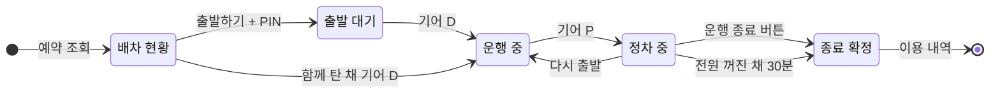

# 코-대리 기획서

## 1. 앱 한 줄 소개

**코-대리는 대리 호출부터 기사 안내와 주차·운행 종료까지 이어 주어, 차주가 편하게 귀가하도록 돕는 Pleos Connect 차량 앱입니다.**

## 2. 기획 배경

### 편하게 부르고, 귀가까지 맡기고 싶은 차주

대리운전을 이용하는 차주는 간편하게 기사를 부르고 목적지까지 편하게 이동하고 싶습니다. 코-대리는 차량에서는 저장된 집이나 음성 입력으로, 차 밖에서는 웹 페이지로 목적지와 요금을 확인하고 대리를 부를 수 있게 합니다. 호출 후에는 차량 위치와 목적지·주차 방법을 전달하고 운행 종료를 확인하는 과정까지 이어 줍니다.

호출 이후의 편안함은 기사님이 필요한 정보를 제때 받는 데서 시작합니다. 기사님은 낯선 차와 주차장에서 목적지와 입구·주차 구역을 다시 확인해야 할 수 있습니다. 차주가 쉬고 있어 설명을 듣기 어려워도 차량이 안내를 이어 주면, 기사님은 운행과 주차를 진행하고 차주는 반복해서 설명하는 부담을 줄일 수 있습니다.

### 시장 현황과 초기 진입 범위

| 조사 항목 | 확인한 수치 | 기준과 출처 |
| --- | --- | --- |
| 국내 대리운전 시장 규모 | 연간 약 2조 7,672억 원 추산 | 국토교통부 「대리운전 실태조사 및 정책연구」, 2020년 4월. 기사 수·운행 횟수·근무일과 회당 요금 가정을 이용한 추정치 [1] |
| 대리운전자 수 | 약 16만 4천 명 | 같은 보고서의 2020년 조사 기반 추정 [1] |
| 호출 경로 | 전화 약 80%, 앱 약 20% | 이투데이 2022년 5월 24일 보도의 업계 추산. 공식 전수 통계가 아님 [2] |

이 자료는 대리운전이 일정 규모의 수요를 가진 시장이며, 앱 이외의 호출 경로도 고려해야 한다는 배경을 보여 줍니다. 조사 시점이 다르므로 현재 시장 규모나 호출 비중으로 단정하지 않습니다. 전체 대리운전 시장이 곧 코-대리의 접근 가능한 시장인 것도 아닙니다. 초기 이용 범위는 Pleos Connect 적용 차량 가운데 서비스를 연결하고 차량·웹으로 호출하는 이용자로 제한됩니다.

전화 호출 이용자는 콜센터가 예약을 코-대리에 전달하는 연동이 있어야 접근할 수 있습니다. 따라서 처음부터 전화 이용자를 앱 호출로 전환시킨다고 가정하지 않고, 차량·웹 호출로 귀가 흐름을 검증한 뒤 제휴 서비스의 접수 경로를 넓히는 순서를 잡았습니다.

### 기존 서비스와의 차이

| 비교 대상 | 공개 자료에서 확인한 기능 | 코-대리가 집중하는 부분 |
| --- | --- | --- |
| 대리 호출 앱 — 카카오 T 대리 사례 | 위치 기반 기사 방문, 요금 추천, 기사 배정과 결제를 제공 [3] | 호출 이후 차량의 기어·착석·상태를 예약과 연결하고, 차 안에서 주차 안내와 종료 절차를 이어 가는 경험 |
| 순정 발레 모드 — 현대차그룹 공개 사례 | 차량 정보를 기록하고, 일부 적용 환경에서는 원격 위치·이동 경로 조회를 지원 [4] | 대리 예약의 배정 정보와 PIN, 기사님을 위한 주차 안내, 종료 결과와 운행 요약을 한 흐름으로 연결 |
| 코-대리의 현재 프로토타입 | 차량 앱·웹·시연 서버로 호출부터 운행 종료까지 구현 | 실제 배차·결제 서비스와 연동하고 실차에서 검증해야 상용 이용 가능 |

위 비교는 공개된 기능과 코-대리의 기획 초점을 정리한 것이며, 다른 서비스에 해당 기능이 전혀 없다는 의미는 아닙니다. 순정 발레 모드와 코-대리를 동시에 사용할 수 있는지도 별도 검증이 필요합니다. 차별화 가설은 위치 표시나 자동 결제 하나가 아니라, **차주가 쉬는 동안 차량 신호와 기사님 안내로 귀가 과정을 이어 가는 경험**입니다. 이 차이가 실제로 추가 조작과 설명을 줄이는지는 시범 운영에서 확인합니다.

### 기사님을 지원해 차주의 귀가를 편하게 만드는 코-대리

코-대리의 ‘코’는 코파일럿·코드라이버처럼 함께하며 지원한다는 의미입니다. 차주에게는 편리한 호출과 귀가를 제공하고, 운행 중에는 기사님을 돕는 동반자 역할을 합니다. 예약의 목적지를 내비게이션으로 전달하고, 집 근처에서는 저장된 주차 방법을 안내하며, 기사님이 운행을 마치면 주차 결과와 운행 요약을 남깁니다.

차량 화면과 음성 안내로 기사님이 운행에 필요한 정보를 확인하도록 지원하고, 기어·착석·위치 신호로 진행 상황과 기록을 연결합니다. 정상적인 귀가에서는 차주의 반복적인 조작·설명을 줄이고, 확인이 필요한 상황은 차주 웹 페이지에 알림으로 남깁니다.

차량 앱의 역할은 호출 화면을 하나 더 제공하는 데 그치지 않습니다. 차량 신호를 이용해 실제 운행의 흐름과 차 안의 안내를 연결하는 데 있습니다. 운행 기록은 다음 날 귀가 과정을 확인하는 용도이며, 분쟁 시 참고가 될 수는 있지만 책임이나 실제 운전자 신원을 입증하는 기능은 아닙니다.

## 3. 앱 주요 기능 및 차량 특화 요소

### 3.1 호출부터 운행 종료까지

| 단계 | 주요 기능 | 차주와 기사님에게 제공하는 편의 |
| --- | --- | --- |
| 처음 이용 | 동의 후 QR 또는 연결 코드로 차량과 휴대폰 연결 | 차주는 연결 후 예약을 매번 차량에 다시 입력하지 않습니다 |
| 호출 | 차량 화면 또는 차주 웹에서 목적지·요금 확인 후 호출 | 차주는 상황에 맞는 경로로 부르고, 차량에서는 집 선택·음성 입력을 이용합니다 |
| 기사 배정 | 배정 정보 표시, 기사님에게 마지막 차량 위치 제공 | 차주는 배차를 확인하고, 기사님은 차량을 찾는 데 참고합니다 |
| 출발 확인 | 배정마다 발급한 네 자리 PIN 확인 | 차주와 기사님이 이번 예약의 배정 정보를 대조합니다 |
| 운행 | 내비 목적지 전달, 차량 신호로 운행 기록 | 기사님의 목적지 재입력과 수동 기록 부담을 줄이고 차주는 쉴 수 있습니다 |
| 집 근처 | 입구·주차 구역을 화면과 음성으로 안내 | 기사님은 차주에게 반복해서 묻는 일을 줄이고 주차를 진행합니다 |
| 도착 | 기사님이 주차 결과를 남기고 운행 종료 | 기사님은 차량 화면에서 마무리하고, 차주는 종료·결제 처리 결과를 확인합니다 |
| 운행 후 | 차주와 기사님에게 각자의 운행 요약 제공 | 차주는 주차 결과·차량 상태를, 기사님은 자신의 운행 내역을 확인합니다 |

현재 예약·배정·결제는 시연용 서버의 가상 데이터로 동작합니다. 실제 대리운전 이용에는 대리운전 서비스와의 연동이 필요합니다. 기사님은 별도 앱을 설치하지 않고 차량 화면과 웹 안내를 이용합니다.

**출발 PIN과 자동 기록은 역할을 구분합니다.** PIN은 서비스가 배정마다 새로 발급하며, 재배정되면 바뀝니다. 기사님이 전달받은 PIN을 차량에 입력해 배정 일치를 확인합니다. 별개로, 버튼이나 PIN 확인 없이 출발하더라도 기록 누락을 줄이기 위해 착석·기어 조건에 따라 기록을 시작할 수 있습니다. 착석 신호를 받지 못하면 기어 기준으로 시작하는 예외도 있으므로, 자동 기록 자체가 기사 확인 완료를 의미하지는 않습니다. PIN은 배정 정보의 대조 수단이며 별도의 신분 인증을 대신하지 않습니다.

**정차와 운행 종료를 구분합니다.** P단으로 잠깐 섰다가 다시 출발하면 같은 운행을 이어 갑니다. 기사님이 ‘운행 종료’를 눌러 종료하며, 목적지에서 직선거리로 1km 넘게 떨어진 경우에는 한 번 더 확인합니다. 위치를 알 수 없으면 이 확인은 생략됩니다. 종료 정보 전송과 서버 확인은 별도 단계이므로, 통신이 끊기면 차량에 저장하고 다시 전송합니다. 앱이 30분 넘게 중단된 뒤 재실행되면 마지막 기록 시각을 기준으로 종료하는 보완 규칙도 있습니다. 이는 전원 차단을 직접 측정한 결과와 구분해야 합니다.

**안내한 주차 위치와 실제 주차 결과를 구분합니다.** 차주가 저장한 안내는 기사님에게 전달할 정보입니다. 실제 세운 자리는 기사님의 선택·입력 결과로 남기며, 운행을 마친 화면에서 수정할 수 있습니다. GPS만으로 지하 주차장의 층이나 주차 칸을 확정하지 않습니다.

차량 이용 내역은 최근 20건을 30일 범위에서 보여 줍니다. 출발·종료 시점의 문·트렁크·창문·잠금·주행거리·배터리 상태를 확인할 수 있으며, 수집하지 못한 값은 확인하지 못한 것으로 표시합니다. 잠금처럼 시간에 따라 달라지는 값은 마지막 확인 시각을 함께 보여 줍니다.

### 3.2 확인이 필요한 상황의 관리

| 상황 | 현재 판단 방식 | 처리 |
| --- | --- | --- |
| 기사님 도착 후 미탑승 | 도착 처리 후 일정 시간 운전석 착석이 확인되지 않음 | 조건이 맞으면 다른 기사님을 요청하고 재배정 사실을 표시합니다 |
| 목적지에서 크게 돌아가는 움직임 | 출발지·현재 위치·목적지의 직선거리로 우회 정도 계산 | 2km와 기준 거리의 30%를 모두 넘으면 경로 확인 알림을 남깁니다 |
| 목적지 밖 장시간 정차 | 목적지에서 500m 넘게 떨어진 곳에서 비주행 상태가 5분 넘게 지속 | 장시간 정차 알림을 남깁니다 |
| 종료 후 잠금 미확인 | 운행 종료 뒤 일정 시간 잠금 신호가 확인되지 않음 | 잠금 확인 알림을 남기며, 신호 수신이 끊긴 경우와 구분해 표시합니다 |

현재 알림은 차주 웹 페이지에서 확인합니다. 문자·푸시 발송은 아직 연동하지 않았습니다. 미탑승 재배정은 시연용 서버에서 최대 두 번 수행하며, 실제 서비스의 대기 시간과 재배정 정책은 연동 시 정해야 합니다.

경로 판단은 도로·교통 상황을 반영한 내비 경로 비교가 아닙니다. 장시간 정차도 P단 자체가 아니라 서버가 받은 비주행 상태를 기준으로 판단하므로 교통 정체 등이 포함될 수 있습니다. 신호가 부족한 상황을 이상 상황으로 단정하지 않으며, 알림은 확인을 돕는 용도입니다. 자동 신고·긴급 출동·사고 예방을 보장하지 않습니다.

### 3.3 차량에서 제공하는 경험

- **차량 신호에 맞춘 진행:** 기어와 착석으로 운행 시작·정차·재출발을 구분하고, 주행거리와 차량 상태를 운행 한 건에 연결합니다.
- **내비게이션과 주차 안내:** 목적지를 내비게이션에 전달하고, 집 주변에 진입하면 저장된 주차 방법을 안내합니다. 음성 안내로 화면을 계속 확인해야 하는 부담을 줄입니다.
- **정차 중심 조작:** 호출과 설정은 P단에서 제공하며, 주행 중에는 조작을 제한합니다. 긴급한 연락처 조회 등 필요한 예외는 별도로 둡니다.
- **필요한 연락과 재이용:** 비상연락처를 등록하면 운행 중 기사님이 차량에서 조회할 수 있고 조회 시각을 남깁니다. 이용 내역에서 ‘우선 요청’ 기사님을 지정할 수 있으며, 실제 우선 배정은 서비스의 수락·배차 정책에 따릅니다.

### 3.4 개인정보와 기록 범위

번호 연결 전에 수집 항목·목적·보관 기간을 안내하고 동의를 받습니다. 차량은 운행 관리에 필요한 위치·기어·착석과 차량 상태를 서버에 전달합니다. 호출 시에는 집을 목적지로 선택한 경우를 포함해 목적지 이름·좌표와 출발 위치를 전송합니다. 집 주차 안내 원문은 차량에 보관합니다.

앱은 음성 입력을 요청한 동안 마이크를 사용하며 음성 원본을 저장하거나 앱 서버로 업로드하지 않습니다. 인식 결과에서 선택한 목적지 등 기능에 필요한 정보는 서버에 전송될 수 있습니다.

기사님에게 차주의 연결 번호를 제공하지 않습니다. 탑승 전 안내에는 목적지와 마지막 차량 위치·확인 시각을 제공하고, 출발 또는 재배정 이후에는 해당 차량 위치 안내를 제한합니다. 운행 후 기사님 요약과 차주용 상세 내역의 공개 범위를 구분합니다. 비상연락처는 평소 가려서 표시하되, 운행 중 차량에서 조회하면 실제 번호를 보여 주고 운행이 끝나면 조회를 제한합니다.

시연 환경은 문자로 번호 소유를 인증하지 않으며, 연결 코드를 통한 차량 접근 확인과 실제 번호 소유 인증은 구분합니다. 번호 하나에는 차량 한 대를 연결하고, 같은 번호를 다른 차량에 연결하면 앞선 차량의 연결이 해제됩니다.

연결을 해제하면 서버의 연결 정보와 해당 연결의 데이터를 삭제합니다. 차량에 남아 있는 이용 내역과 집 주차 안내는 별도로 관리합니다. 기록은 관측한 차량 상태·서비스의 배정 정보·사람이 입력한 결과를 구분하며, 운전자 평가 점수는 만들지 않습니다.

## 4. 주요 사용 시나리오

### 4.1 금요일 회식 후 귀가

**처음 이용할 때:** 차주는 차량의 연결 QR을 휴대폰으로 읽고 동의·번호 연결을 마칩니다. 집 주차장 입구와 주차 구역, 필요한 비상연락처를 등록합니다.

**대리를 부를 때:** 식당에서 차주 웹 페이지로 목적지와 요금을 확인하고 대리를 부릅니다. 이미 차 안에 있다면 P단에서 ‘집’이나 음성 입력으로 호출할 수도 있습니다. 차량 앱이 실행되어 예약을 조회하면 배차 현황이 표시되고, 기사님은 웹 안내에서 차량의 마지막 위치와 확인 시각을 확인합니다.

**기사님이 도착하면:** 차량에서 배정 정보와 PIN을 대조합니다. 차주는 뒷자리에서 쉬고, 출발하면 차량이 운행을 기록하고 내비게이션으로 목적지를 안내합니다.

**집 근처에 도착하면:** 코-대리가 ‘동쪽 입구로 들어가 지하 2층 B구역’처럼 저장한 주차 방법을 안내합니다. 차단기 앞에 잠깐 정차했다가 출발해도 같은 운행을 이어 갑니다.

**주차를 마치면:** 기사님이 세운 자리를 선택하고 ‘운행 종료’를 누릅니다. 서버가 종료 정보를 확인하면 모의 결제 결과와 이용 내역이 표시됩니다. 차주 페이지에는 주차 결과와 차량 상태가 남고, 기사님은 운행 요약을 확인합니다. 다음 날 차주는 주차 위치와 마지막 잠금 확인 시각을 확인할 수 있습니다.

이 흐름에서 차주는 처음 연결과 호출 이후, 주차 방법을 반복해서 설명하거나 운행 기록을 직접 시작·종료할 필요를 줄일 수 있습니다. 실제 배차·결제·문자 알림은 대리운전 서비스 연동 후 제공할 범위입니다.

### 4.2 기사님의 이용 흐름

기사님은 별도 앱 설치 없이 탑승 전 웹 안내에서 차량의 마지막 위치와 확인 시각, 배정된 PIN을 확인합니다. 차량에서는 PIN으로 배정 정보를 대조하고, 내비게이션으로 전달된 목적지에 따라 운행합니다. 집 근처에서는 저장된 입구·주차 구역을 안내받아 차주에게 다시 묻는 부담을 줄입니다.

주차를 마치면 실제 세운 자리를 선택하고 운행을 종료합니다. 연락이 필요한 상황에서는 운행 중 차량에서 비상연락처를 조회할 수 있습니다. 운행 후에는 자신의 운행 요약을 확인합니다. 차주가 쉴 수 있도록 기사님에게 필요한 정보와 마무리 수단을 제공하는 흐름입니다.

### 4.3 확인이 필요한 경우

기사님이 도착했다고 했지만 착석이 확인되지 않으면 재배정을 시도합니다. 운행 중 크게 돌아가거나 목적지 밖에서 오래 멈추면 차주 페이지에 확인 알림이 남습니다. 기사님이 목적지에서 먼 곳에서 종료하려 하면 차량이 한 번 더 묻습니다.

차주를 깨우기 어려워 연락이 필요하면 기사님은 운행 중 차량에서 비상연락처를 조회할 수 있습니다. 위치·착석·잠금 신호를 받지 못하거나 통신이 끊기면 확인하지 못한 상태를 표시하고, 저장한 운행 정보는 연결이 회복된 뒤 전송합니다. 차량 위치만으로 주차장 입구·층을 알 수 없을 때는 추가 설명이 필요할 수 있습니다.

## 5. 개발 계획

### 5.1 개발 범위와 현재 상태

현재 차량 앱과 시연용 서버·웹 페이지를 구현했습니다. 기능 설명은 차량 앱 0.8.89 코드 대조를 바탕으로 정리했으며, 0.8.90의 연결 해제 안내와 최신 문서의 번호 확인 범위를 반영했습니다. 에뮬레이터 확인 자료는 7번에 첨부하며, 실제 차량 검증과 상용 대리운전 서비스 연동은 별도로 진행해야 합니다.

| 구분 | 현재 구현 | 후속 개발·확인 |
| --- | --- | --- |
| 차량 앱 | 연결, 호출, 배차 표시, PIN 확인, 운행 기록, 내비 연동, 주차 안내, 종료, 이용 내역, 연락처 조회 | 실차 신호·권한·음성·앱 생명주기 검증 |
| 서버·웹 | 가상 예약·기사 배정, 상태 판단·알림, 모의 결제, 차주 페이지, 기사 안내·운행 요약, 심사용 콘솔 | 실제 예약·배차·결제 시스템 연동 |
| 번호 확인 | 문자 인증 없이 번호와 차량 연결 코드로 연결. 심사용 콘솔은 연결된 번호로 차주 화면 조회 가능 | 실제 서비스의 번호 소유 확인·인증 연동 |
| 알림 | 웹 페이지에 표시 | 문자·푸시 발송 연동 및 전달 확인 |
| 우선 요청 | 선호 기사 저장과 시연 배정 | 실제 기사 수락·거절·대체 배정 절차 연동 |
| 호출 경로 | 차량 화면과 차주 웹 페이지 | 전화·콜센터 예약 연동 가능성 검토 |

가족 등 다른 번호로 접수한 예약을 차량에 연결하는 기능은 현재 제공하지 않으며, 확정된 개발 범위에도 넣지 않습니다. 별도 차주용 휴대폰 앱과 음성 비서 연동 역시 현재 출품 기능이 아닙니다.

### 5.2 기획 명세

개발에 들어가기 전에 정한 기능 요구사항과 규칙입니다. 만들면서 바뀌었거나 아직 만들지 않은 부분은 5.1의 현재 상태를 따릅니다.

#### 기능 요구사항

| 언제 | 기능 | 쓰는 신호 |
| --- | --- | --- |
| 처음 한 번 | F1 차와 번호 연결 | |
| 부를 때 | F2 대리 부르기 | 기어, 음성 인식, 위치 |
| 배정된 뒤 | F3 배차 현황 (타면 예약이 나타남) | |
| 배정된 뒤 | F4 기사님에게 차 위치 알리기 | 위치 |
| 출발할 때 | F5 출발 확인과 기사님 PIN | 착석, 기어 |
| 달리는 동안 | F6 운행 기록과 내비 연동 | 기어, 주행거리, 위치, 내비 |
| 집 근처 | F7 집 주차 안내 | 위치, 음성 안내 |
| 도착했을 때 | F8 운행 종료와 결제 | 기어, 착석, 위치 |
| 다음 날 | F9 이용 내역과 우선 요청 기사님 | 문, 잠금, 창문, 배터리 |
| 급할 때 | F10 비상연락처 | |

**F1 차와 번호 연결**
- 무엇을 모으고 얼마나 보관하는지 먼저 알리고, 차주가 "동의하고 연결"을 누른 뒤에만 연결 QR을 띄웁니다.
- QR은 한 번만 쓸 수 있고 10분 동안 유효합니다. 휴대폰 없이도 연결할 수 있도록 QR 아래에 연결 코드를 함께 보여 줍니다.
- 회원가입과 비밀번호는 두지 않습니다. 연결을 해제하면 동의도 철회됩니다.

**F2 대리 부르기**
- 차 안에서는 P단에 섰을 때만 부를 수 있습니다. 기어 값을 받을 수 없으면 막고, 달리는 중에는 "정차 중에만 이용할 수 있습니다."라고 보여 줍니다.
- 목적지는 "집", "목적지 선택", "말로 입력" 가운데 하나로 정합니다. 출발지, 목적지, 예상 거리, 확정 요금을 보여 주고 읽어 준 뒤, 차주가 "부르기"를 누르거나 "불러 줘"라고 답해야 예약합니다.
- 말을 알아듣지 못하면 들은 말을 보여 주고 다시 묻습니다. 짐작해서 예약하지 않습니다.
- 기사님이 출발하기 전에는 "호출 취소"로 예약을 취소할 수 있습니다.
- 차 밖에서 부른 예약도 같은 번호로 들어오면 차에 잇습니다. 전화로 부른 예약은 콜센터가 발신 번호를 붙여 넘겨 줄 때 이을 수 있습니다.

**F3 배차 현황 (타면 예약이 나타남)**
- 기사님이 배정되면 메인 화면의 "대리 부르기"가 "배차 현황"으로 바뀌고 저절로 열립니다. 예약을 찾으려고 누를 것이 없게 합니다.
- "배정된 기사님 김○○ · 판교 삼평동 · 확정 25,000원"처럼 보여 줘, 차주가 화면의 이름과 눈앞의 기사님을 맞춰 볼 수 있게 합니다.
- 예약이 취소되거나 기사님이 바뀌면 화면도 따라 바뀝니다.

**F4 기사님에게 차 위치 알리기**
- 기사님이 받는 "탑승 전 안내" 페이지에 차가 마지막으로 보낸 위치를 지도 링크와 "몇 분 전 기준"으로 보여 줍니다. 위치를 아직 받지 못했으면 "아직 받지 못함"으로 적습니다.
- 이 위치는 배정부터 출발까지만 보여 주고, 출발하거나 다른 기사님이 배정되면 닫습니다.
- 차주가 주차장 어디에 차가 있는지 전화로 설명하지 않아도 되게 합니다.

**F5 출발 확인과 기사님 PIN**
- 예약이 있는 차가 서 있고 운전석과 다른 자리(조수석이나 뒷좌석)에 사람이 앉으면 메인 화면에 "출발하기"를 크게 띄웁니다. 누르면 PIN 네 자리를 묻습니다.
- PIN은 서비스가 배정할 때마다 새로 만들어 기사님과 차에만 보냅니다. PIN이 맞으면 "출발 대기 중"으로 바뀌고, D단으로 출발하면 운행을 시작합니다.
- 버튼을 누르지 않고 출발해도 두 사람이 함께 타 있으면 기록을 시작합니다. 기록이 빠지지 않게 하기 위해서입니다. 혼자 모는 주행은 대리 운행으로 보지 않습니다.
- 착석 신호를 받을 수 없는 차에서는 배차 현황의 "출발하기"를 누르고 출발합니다.

**F6 운행 기록과 내비 연동**
- 출발 시각, 주행거리, 달린 시간을 적고, 예약한 목적지를 순정 내비게이션에 넘깁니다.
- 출발할 때 기사님에게 한 문장을 읽어 줍니다. "대리 운행의 시간과 거리, 차량 상태를 기록합니다. 영상과 음성은 저장하지 않습니다."
- 운행하는 동안에는 내비 지도가 앞에 있고, 코-대리는 지도를 가리지 않습니다. 앱 화면이 가려져 있으면 지도 위에 작은 표시만 두 줄로 띄우고, 알릴 것이 있을 때만 펼칩니다.
- 끝까지 예약과 이어지지 않은 주행은 차주의 평소 주행이므로 기록에 남기지 않습니다.

**F7 집 주차 안내 (선택)**
- 차주는 집 위치, 주차 층과 구역·자리, 기사님에게 전할 말을 나눠서 등록합니다. 꼭 필요한 칸만 채우면 저장할 수 있게 합니다.
- 운행 중 차가 집 반경 밖에 있다가 안으로 들어오면 안내를 읽어 줍니다. 달리는 동안 화면에는 한 줄만 보이고, 나머지는 음성으로 전합니다.
- 이용 내역에는 이 내용을 실제 주차 위치가 아니라 "안내한 위치"로 적습니다.

**F8 운행 종료와 결제**
- P단으로 서면 "정차 중" 화면을 엽니다. 차단기 앞에서 섰다가 다시 출발하면 같은 운행으로 이어 적습니다.
- 운행은 기사님이 "운행 종료"를 눌러야 끝납니다. 잠깐 세우고 내리는 경우와 구분하려고, 운전석이 비는 것만으로는 끝내지 않습니다. P단에서 운전석이 비었는데 누르지 않았으면 "운행을 마치셨다면 화면의 운행 종료를 눌러 주세요."라고 한 번 알려 줍니다.
- 목적지에서 직선거리로 1km 넘게 떨어진 곳에서 누르면 "목적지에서 먼 곳입니다. 정말 운행을 종료할까요?"라고 한 번 더 묻습니다. 위치나 목적지 좌표를 모르면 묻지 않습니다.
- 운행 종료를 누르지 않은 채 차 전원이 꺼지고 30분이 지나면, 다음에 차가 켜질 때 마지막으로 켜져 있던 시각으로 운행을 끝내고 "차 전원 꺼짐"으로 적습니다.
- 운행 종료가 확정되면 결제로 넘어갑니다. 실제 결제는 대리운전 서비스의 결제나 차량 내 결제(인카 페이먼트)와 잇습니다.
- 기사님은 차를 세운 자리를 고르거나 말로 남기고, 운행을 마친 화면에서 고칠 수 있습니다.

**F9 이용 내역과 우선 요청 기사님**
- 차 화면의 "이용 내역"(최근 20건, 30일 보관)과 차주 휴대폰 페이지에 운행마다 기록을 남깁니다.
- 이용 시간, 목적지, 요금, 실제 주차 위치, 문 잠금 상태를 먼저 보여 주고, "차량 상태 자세히"에서 출발할 때와 운행을 마칠 때의 문, 트렁크, 잠금, 창문, 주행거리, 배터리 사용량을 나란히 보여 줍니다. 잠금은 "23:43 기준 잠김"처럼 마지막으로 확인한 시각과 함께 적습니다.
- 기사님 줄의 별 버튼("우선 요청")을 누르면 다음 호출을 그 기사님에게 먼저 물어봐 달라고 요청합니다. 그 기사님이 받지 못하면 다른 기사님에게 넘깁니다. 손님 번호는 기사님에게 넘기지 않습니다.

**F10 비상연락처**
- 차주는 차 설정이나 휴대폰 페이지에서 비상연락처(관계와 번호, 3명까지)를 등록합니다. 번호는 서비스에만 두고, 차 화면에는 가려서 보여 줍니다.
- 도착했는데 차주를 깨울 수 없을 때처럼 급할 때는 기사님이 운행 중이나 정차 중 화면에서 "비상연락처 보기"를 눌러 번호를 확인합니다. 이 버튼은 등록 여부와 상관없이 늘 같은 자리에 둡니다.
- 기사님이 번호를 확인한 사실과 시각은 차주 휴대폰 페이지에 남기고, 운행이 끝나면 번호를 더는 보여 주지 않습니다.

#### 운행 상태 정의

| 상태 변화 | 조건 | 차가 하는 일 |
| --- | --- | --- |
| 배차 현황 → 출발 대기 | 운전석과 다른 자리에 사람이 앉고, 기사님이 "출발하기"를 눌러 PIN을 넣습니다 | "출발 대기 중"을 띄웁니다 |
| 출발 대기 → 운행 중 | 기어가 P를 벗어납니다 | 기록을 시작하고, 출발 안내를 읽고, 목적지를 내비에 넘깁니다 |
| 운행 중 → 정차 중 | 기어를 P에 둡니다 | "정차 중" 화면을 엽니다 |
| 정차 중 → 운행 중 | 다시 출발합니다 | 같은 운행으로 이어 적습니다 |
| 정차 중 → 종료 확정 | 기사님이 "운행 종료"를 누릅니다. 목적지에서 1km 밖이면 한 번 더 묻습니다 | 종료 신호를 보내고, 서비스가 확정합니다 |

#### 확인이 필요한 상황의 관리 원칙

- 차는 예약을 물을 때 운전석 착석, 주행 여부, 위치를 함께 보내고, 판단은 서비스가 합니다. 아무 일이 없으면 아무것도 알리지 않습니다.
- 기준은 3.2의 네 가지 상황입니다. 경로는 실제 도로 대신 직선거리로 단순하게 판단하는 데서 시작하고, 기준값은 실제 운행 데이터로 다시 맞춥니다.
- 착석 신호를 받을 수 없거나 믿기 어려운 차에서는 착석을 "모름"으로 보내고, 그동안은 기사님을 바꾸지 않습니다.
- 알림은 차주 휴대폰 페이지의 알림 칸에 먼저 띄우고, 문자와 푸시는 서비스와 연동할 때 더합니다.
- 차주가 "운행 상태 자동 공유"를 켜면 비상연락처와 따로 3명까지 공유할 연락처를 정합니다. 누구에게 알리는지는 차주 페이지에 보여 줍니다.

#### 화면 기획

메인 화면에는 버튼을 세 개만 둡니다. 왼쪽의 큰 카드는 "대리 부르기"이고, 기사님이 배정되면 "배차 현황"으로 바뀝니다. 오른쪽 두 줄은 "이용 내역"과 "설정"입니다. 운행을 시작하면 운행 중, 정차 중, 마친 화면이 차 신호에 따라 저절로 바뀌고, 운행이 끝나면 메인 화면으로 돌아옵니다.

| 화면 | 언제 | 주요 내용 |
| --- | --- | --- |
| 연결 | 처음, 연결을 해제한 뒤 | 무엇을 모으는지 안내, "동의하고 연결", 일회용 QR, 연결 코드 |
| 메인 | 평소 | "대리 부르기" 또는 "배차 현황", "이용 내역", "설정". 달리는 중에는 "정차 중에만 이용할 수 있습니다." |
| 대리 부르기 | P단일 때 | "집", "목적지 선택", "말로 입력". 부르기 전 확인("부르기", "취소") |
| 배차 현황 | 배정된 뒤 | 배정된 기사님, 목적지, 확정 요금, "호출 취소", "출발하기" |
| PIN 입력 | "출발하기"를 누르면 | 네 자리 입력, "확인", "취소" |
| 운행 중 | 기어 D | 목적지, "지도로 돌아가기", "비상연락처 보기". 후진할 때는 "주차 중"으로 바꾸고 안내 음성을 멈춥니다 |
| 내비 위 표시 | 앱 화면이 가려져 있을 때 | 운행 중 한 줄, 배정된 기사님, 주차 안내 |
| 정차 중 | 기어 P | 거리, 시간, 요금, 주차 자리, "운행 종료", "비상연락처 보기" |
| 운행을 마친 화면 | 운행 종료를 확정한 뒤 | 결제, 주차 위치(수정), 문 잠금 |
| 이용 내역 | 메인에서 | 운행 목록, "차량 상태 자세히", "전화하기", "우선 요청" |
| 설정 | 메인에서 | 집 주차 안내, 비상연락처, 운행 상태 자동 공유, 우선 요청 기사님, 이용 알림, 번호 연결 |

#### 지키는 원칙

- 차가 본 것과 판단을 나눕니다. 차가 본 것, 서비스가 알려 준 것, 사람이 확인한 것을 화면에서 구분해 적습니다.
- 차는 기록하되 평가하지 않습니다. 급가속 점수 같은 평가는 만들지 않고, 기록한다는 사실을 기사님에게 먼저 알립니다. 기록은 운행 확인과 이용 내역에만 씁니다.
- 기록은 양쪽의 것입니다. 기사님도 같은 운행 요약을 받습니다.
- 달리는 동안에는 조작을 받지 않습니다. 대리 부르기와 설정은 P단에서 할 수 있고, "비상연락처 보기"만 예외로 둡니다.
- 통신이 끊겨도 기록은 차에 남고, 다시 연결되면 올립니다. 받지 못한 값은 "확인하지 못함"으로 남깁니다.

#### 리스크와 대응

| 리스크 | 대응 |
| --- | --- |
| 차는 운전자가 누구인지 모릅니다 | 화면에는 "배정된 기사님"으로 적고, 출발할 때 PIN으로 한 번 더 확인합니다. 마지막 확인은 차주의 눈으로 합니다 |
| 시동이 꺼진 차는 서버 알림을 받지 못할 수 있습니다 | 시동이 걸린 뒤 차가 예약을 묻습니다. 화면에 뜨기까지 15~30초로 봅니다. 그 전에 출발하면 일단 기록하고, 달리는 동안 예약과 잇습니다 |
| 통신이 돌아온 뒤 지난 예약을 지금 주행에 잘못 이을 수 있습니다 | 예약의 유효 시간과 배정 상태가 맞을 때만 잇습니다 |
| 착석 신호의 정확도가 차종마다 다를 수 있습니다 | 운행 종료는 착석이 아니라 버튼으로 정합니다. 착석을 모를 때는 기사님을 바꾸지 않습니다 |
| 잠깐 세우고 내린 것을 운행 종료로 잘못 볼 수 있습니다 | 운행 종료는 기사님의 버튼으로만 정합니다. 목적지에서 먼 곳이면 한 번 더 묻습니다 |
| 공모전 SDK에는 결제가 없습니다 | 모의 결제로 보여 주고, 실제 결제와 기사 정산은 서비스를 출시할 때 정합니다 |
| 차 안 음성 호출의 목적지 검색과 요금 | 시연에서는 집과 예시 장소 몇 곳, 직선거리 요금으로 한정합니다. 서비스와 연동하면 실제 장소 검색과 요금으로 바꿉니다 |
| 대리 호출의 대부분은 전화로 들어오는데, 이 앱은 전화 호출을 받지 않습니다 | 호출을 차로 옮기려 하지 않습니다. 콜센터가 발신 번호로 예약을 넘기면 같은 방식으로 차에 잇습니다. 연동 전까지는 차 화면과 웹으로 부른 운행만 차에 이어집니다 |
| 외부 사업자에게 차량 API(디지털 키 공유, 발레 모드, 카메라)가 어디까지 열려 있는지 모릅니다 | 공모전 SDK로 할 수 있는 범위부터 만들고, 개방 범위를 확인합니다 |
| 차에 들어가도 배차가 되지 않으면 쓸모가 없습니다 | 기사 공급(업체 제휴, 콜 공유 프로그램 연동)은 대리운전 서비스가 맡습니다. 그 전까지는 시연용 서버로 보여 줍니다 |

#### 앱 구조

차량 앱은 다섯 계층으로 나눕니다. 안쪽 계층이 바깥 계층을 모르게 해서, 운행 규칙을 차 없이 가짜 신호와 가상 시간으로 시험할 수 있게 합니다.

| 계층 | 하는 일 |
| --- | --- |
| 도메인 | 운행 시작·정차·종료 판정, 이용 내역, 주차 안내, 음성 호출의 규칙을 둡니다. 안드로이드에 기대지 않습니다 |
| 흐름 | 번호 연결, 예약 맞추기, 부르기, 운행 기록, 주차 안내, 비상연락처, 내비 전달, 이용 내역 보내기를 하나씩 맡습니다 |
| 데이터 | 차 안에 저장하고 서버와 주고받습니다 |
| 차량 | Pleos SDK 신호, 위치, 음성 인식과 안내, 내비게이션을 다룹니다 |
| 화면 | 상태를 받아 그리기만 합니다. 어떤 화면을 띄울지는 상태로 정합니다 |

#### 개발 순서

| 단계 | 만들 것 |
| --- | --- |
| 1 | 번호 연결(동의, 일회용 QR, 연결 해제), 예약 조회, 배차 현황 |
| 2 | 출발 확인과 PIN, 운행 기록, 정차와 운행 종료 단계, 출발할 때와 운행을 마칠 때의 차 상태, 내비 목적지 전달 |
| 3 | 정차 중 화면, 주차 위치, 자동 결제(모의), 이용 내역, 우선 요청 기사님 |
| 4 | 확인이 필요한 상황 알림 네 가지, 비상연락처, 운행 상태 자동 공유 |
| 5 | 말로 대리 부르기, 집 주차 안내, 내비 위 표시 |
| 6 | 시연용 서버와 웹 페이지, 심사용 콘솔, 시연 영상, 서명한 release APK |

### 5.3 시스템 구성

| 구성 | 기술 | 역할 |
| --- | --- | --- |
| 차량 앱 | Kotlin, Jetpack Compose, Pleos SDK | 차량 신호 수집, 운행 상태 관리, 화면·음성 안내, 로컬 저장과 재전송 |
| 서버 | Cloudflare Workers, Durable Objects | 차량·휴대폰 연결, 예약·배정, 상태 판단, 종료 확인, 이용 내역 |
| 웹 페이지 | 차주·기사님 페이지와 심사용 콘솔 | 호출·조회, 탑승 전 안내와 운행 요약, 시연 조작 |

차량 앱은 차량·통신 접근과 운행 판단 규칙을 분리해 가짜 신호와 시간으로 규칙을 시험할 수 있게 구성했습니다. 차량이 서버에 예약과 상태를 주기적으로 조회하며, 서버가 꺼진 차량을 깨워 화면을 여는 구조는 아닙니다. 통신 실패 시에는 로컬 기록과 전송 대기를 유지합니다.

### 5.4 SDK와 API 사용 계획

| SDK·API | 사용 범위 |
| --- | --- |
| Vehicle | 기어·착석·주행거리·문·트렁크·잠금·창문·배터리 상태 확인 |
| FusedLocation | 차량 위치, 집 근처 진입, 목적지와의 거리 판단 |
| NaviHelper | 내비게이션에 목적지 전달 |
| TextToSpeech·SpeechToText | 음성 안내와 목적지 입력 |
| CarUxRestrictions | 주행 중 조작 제한 |
| HTTPS API·로컬 저장 | 연결·예약·차량 상태·이용 내역 송수신과 오프라인 보관 |

다른 앱 위에 띄우는 배너는 현재 비활성화되어 있으며 관련 권한도 요청하지 않습니다. 차량 신호·음성·백그라운드 동작을 포함한 실제 권한 승인과 차종별 제공 범위는 실차 및 앱 마켓 심사 과정에서 확인해야 합니다. 공모전 출품 범위에는 차량 내 결제 API를 통한 실결제를 포함하지 않습니다.

### 5.5 검증 및 고도화 순서

1. 현재 프로토타입에서 정상 귀가와 미탑승·우회·장시간 정차·잠금 미확인 흐름을 반복 확인하고, 소스·APK·시연 자료의 버전을 맞춥니다.
2. 신호 누락, 앱 중단·재시작, 통신 단절, 중복 요청, PIN 미확인 상태를 검증합니다. 실차에서는 잠금 신호 수신 시점, 음성 출력, 좌석 신호, 내비 화면이 열린 동안의 안내, 시동 전후 동작을 확인합니다.
3. 제휴 서비스가 정해지면 실제 배차·기사 PIN 전달·결제·알림을 연동하고 실패·취소·정산 절차를 검증합니다. 적용 서비스와 일정은 확정 후 제시합니다.
4. 시범 운영으로 안내 성공률·오탐·사용자 개입과 재이용을 측정하고 기준을 조정합니다.

에뮬레이터에서 동작하는 것과 실차·상용 서비스에서 검증된 것은 구분합니다. 자동 기록은 대리 운행을 잘못 연결할 수 있고, 직선거리 기반 알림은 정상 운행에도 발생할 수 있습니다. 앱 중단은 전원 꺼짐과 같지 않으므로 관측 시각과 수집 공백을 표시하고, 실제 운전자·사고 여부·안전 상태를 단정하지 않습니다.

## 6. 기대효과 및 발전 가능성

### 6.1 사용자에게 제공하는 가치

**차주에게는 편리한 호출과 귀가를 제공합니다.** 차량에서 집을 선택하거나 목적지를 말해 대리를 부르고, 차 밖에서는 웹으로 호출합니다. 탑승 후에는 기사님에게 목적지와 주차 방법을 반복해서 설명하는 부담을 줄이며, 다음 날 주차 결과와 확인된 차량 상태를 한곳에서 봅니다.

**기사님에게는 운행에 필요한 정보와 마무리 수단을 제공합니다.** 마지막 차량 위치, 내비 목적지, 주차 안내를 확인하고 차량 화면에서 주차 결과 입력과 운행 종료를 진행합니다. 차주를 깨워 다시 묻거나 목적지를 재입력하는 부담을 줄이며, 별도 앱 설치 없이 자신의 운행 요약을 확인합니다. 만족한 차주의 ‘우선 요청’으로 다시 선택받을 접점도 제공하되, 실제 배정은 서비스 정책에 따릅니다.

차량 플랫폼에는 차량 데이터와 내비·음성을 일상의 서비스 흐름에 연결하는 사례를 제공합니다. 대리운전 서비스에는 배정 이후의 운행 상태와 안내·종료 흐름을 연결할 접점을 제공합니다. 분쟁 시 기록을 참고할 가능성은 있으나 분쟁 해결·책임 입증·보험 적용을 보장하지 않습니다.

### 6.2 타깃 고객과 이용 지표

첫 타깃은 Pleos Connect 차량을 이용하며 회식이나 모임 후 대리운전을 반복 이용하는 차주입니다. 초기에는 차량·웹 호출 이용자 가운데 주차 안내를 반복하거나 귀가 후 주차 결과를 확인해야 하는 이용자를 대상으로 편의 효과를 검증합니다. 2번의 과거 전화 호출 비중을 현재의 고객 비중으로 대입하지 않으며, 전화 이용자는 콜센터 예약 연동이 이루어진 뒤 접근 가능한 고객으로 구분합니다. 실제 이용 빈도, 추가 설명의 부담과 서비스 이용 의향은 사용자 인터뷰와 시범 운영으로 확인합니다.

실제 적용 차량 수와 월간 이용률이 확인되지 않아 MAU를 확정 수치로 제시하지 않습니다. 산정 예시로 적용 차량 10만 대 × 번호 연결률 5% × 연결 차량의 월간 이용률 40%라면 월 이용 차량은 2,000대입니다. 차량당 월 이용자 1명, 월 2회 이용을 가정하면 MAU는 약 2,000명, 월 운행은 약 4,000건입니다. 모두 산정 방식을 설명하기 위한 가정이며 실측·예측 결과가 아닙니다.

| 지표 | 측정 기준 |
| --- | --- |
| 연결 전환율 | 앱을 이용한 차량 중 번호 연결을 완료한 비율 |
| 차주의 추가 개입 | 호출 후 종료까지 추가 조작·설명이 필요했던 횟수. 설명 횟수는 동의받은 사용성 조사로 확인 |
| 기사님 이용 편의 | 목적지·주차 방법 재확인 횟수, 주차 결과 입력·종료 완료율과 사용성 조사 |
| 기록·종료 성공률 | 확인된 대리 운행 중 기록과 서버 종료 확인이 완료된 비율. PIN 확인 여부는 별도로 집계 |
| 알림 정확도 | 알림 발생·확인·조치율과 정상 상황에서 발생한 오탐률 |
| 다음 달 재이용률 | 이번 달 이용자 중 다음 달에도 이용한 비율. 차량 기준 집계 시 별도 표기 |

Retention Rate는 시범 운영 후 측정합니다. 대리 이용 빈도에 따라 월별 변동이 클 수 있으므로 이용 기회가 있었는지도 함께 확인합니다. 문제를 예방한 건수나 분쟁 비용 감소는 현재 입증한 성과로 제시하지 않습니다.

### 6.3 서비스 확대와 사업화

우선 실제 대리운전 서비스와 배차·결제·알림을 연결해 편리한 호출부터 기사 안내·주차·운행 종료까지의 흐름을 완성하는 것이 목표입니다. 이후 전화·콜센터로 접수한 예약 연결, 내비게이션의 경로·도착 정보 활용, 차량별 안내 개선을 검토합니다. 외부 SDK·서비스·권한 제공 여부에 따라 범위와 일정을 정합니다.

차주에게 무료로 제공하고 제휴 대리운전 서비스가 비용을 부담하는 모델을 검토합니다. 제휴 조건·요금·수익 배분은 확정되지 않았습니다. 우선 이용 편의와 재이용 효과를 확인한 뒤 사업성을 검증합니다.

## 7. 참고자료(선택 · 가산점 부여)

- [GitHub 저장소](https://github.com/raphael1063/co-daeri): 소스 코드와 실행·설정 안내
- [APK](../apk/테오로빈_코-대리_release.apk): 설치 파일. 최종 제출 시 소스와의 버전을 확인합니다.
- [시연 영상](영상/코-대리_시연영상.mp4): 호출부터 귀가까지의 동작 흐름
- [에뮬레이터 확인 기록](검증/README.md): 확인한 동작과 미확인 항목
- [심사용 콘솔](https://lrlr-master.com/daeri/console/): 가상 예약·배정·문제 상황을 조작하는 시연 환경
- [차량 데이터 조사](조사/Pleos_Connect_데이터_목록.md), [앱 동작 범위 조사](조사/Pleos_Connect_앱_자유도.md): SDK와 환경 검토 자료
- [공식 공모전 접수양식](https://appdevchallenge.auto-hmg.io/downloads/contest-application-consent.docx), [지원·제출 안내](https://appdevchallenge.auto-hmg.io/guide/submission): 본 문서의 항목·순서 기준

### 시장 및 대체 서비스 조사 출처

- [1] [국토교통부 「대리운전 실태조사 및 정책연구」 최종보고서](https://www.codil.or.kr/filebank/original/RK/OTKCRK240591/OTKCRK240591.pdf), 2020년 4월. 보고서 요약 2.3 및 시장 규모 산정 부분.
- [2] [이투데이 「‘반쪽짜리’ 대리운전 中企 적합업종 지정…‘전화콜’만 제동건 동반위」](https://www.etoday.co.kr/news/view/2137036), 2022년 5월 24일. 호출 비중에 관한 당시 업계 추산만 인용하며, 제도 관련 내용은 현재 상황의 근거로 사용하지 않습니다.
- [3] [카카오모빌리티 카카오 T 대리 공식 서비스 소개](https://www.kakaomobility.com/service-kakaot/driver). 공개된 기능 범위를 비교에 사용했습니다.
- [4] [현대자동차그룹 「현대차그룹 인포테인먼트, 소프트웨어 업데이트로 스마트한 사용자 경험을 대폭 강화하다」](https://www.hyundaimotorgroup.com/ko/amp/CONT0000000000050086), 2022년 8월 23일, ‘실시간 위치 및 이동 경로 지원하는 발레 모드’. 적용 차종·서비스별 차이가 있으며 Pleos Connect 전체의 동일 기능 제공을 뜻하지 않습니다.

## 8. 숏폼 링크(선택 · 가산점 없음) *공모전 본상과 별도로 운영되는 특별상(50만원)

미제출.
